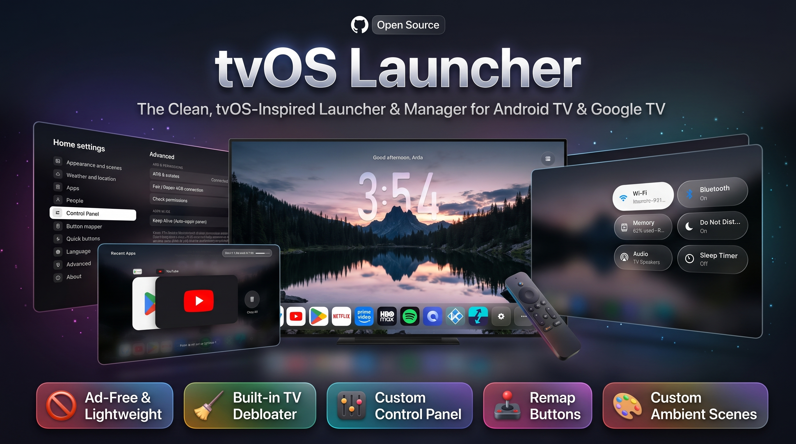
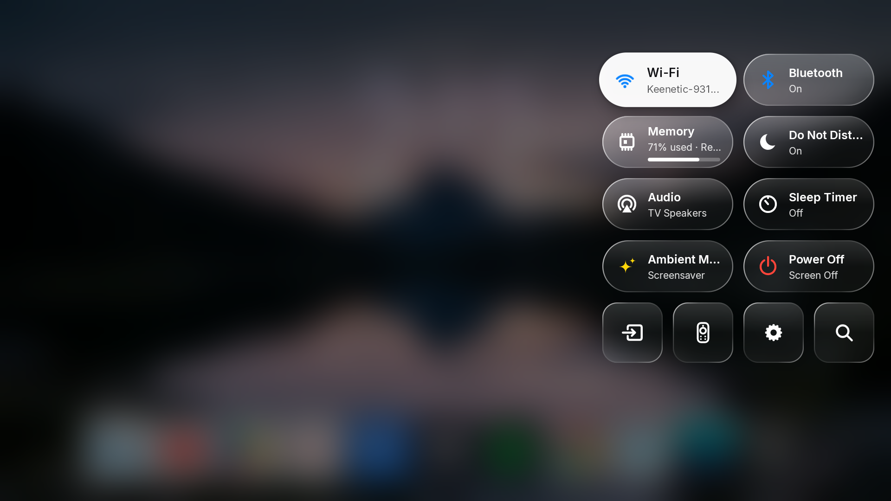
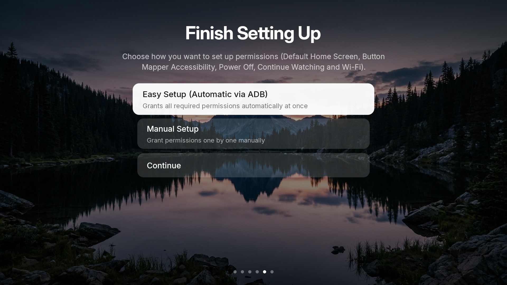
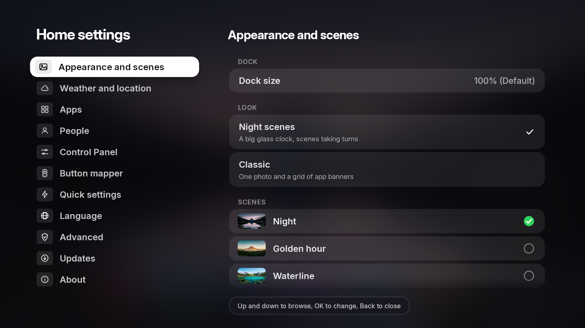
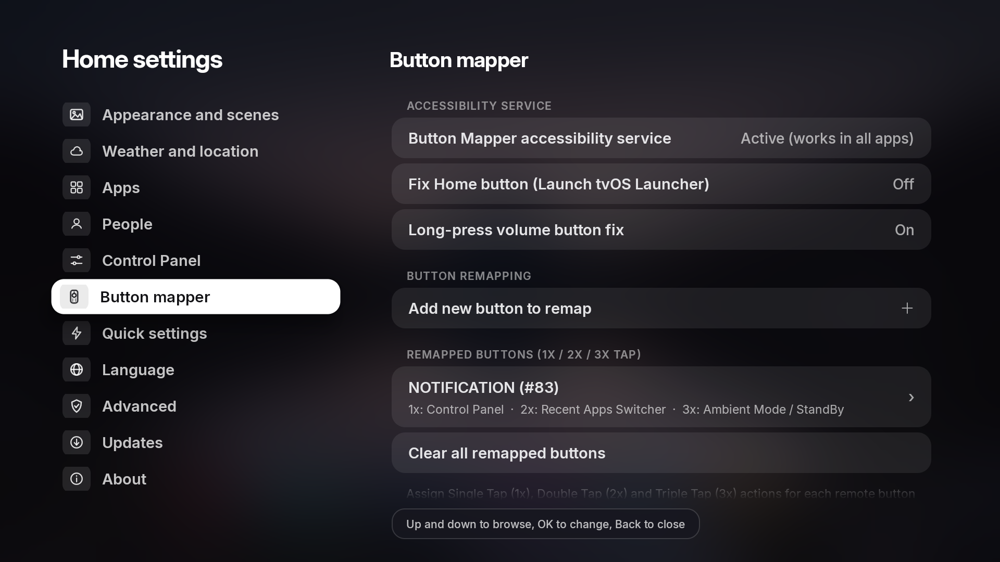

# tvOS Launcher (`v2.2.5`)

> 📦 **Скачать последний APK (`v2.2.5`):** **[GitHub Releases](https://github.com/techgenius1/tvOS-Launcher/releases/latest)**



Быстрый, лёгкий главный экран в стиле tvOS 26 и macOS для Android TV и Google TV — написан на чистом Java без сторонних runtime-зависимостей (**~5.7 MB APK, `0.0%` CPU в фоне, встроенный рендеринг Liquid Glass, навигация в 60 FPS**). Рассчитан на плавную работу от **Android 6.0 (API 23)** до **Android 14+** даже на ТВ-приставках с 1 ГБ ОЗУ, при этом предлагает **масштабируемый многострочный док Liquid Glass (`50%–150%`, `1–3 строки`)**, **всплывающее окно приложений в стиле macOS 26**, **нативное модальное окно универсального поиска Liquid Glass с ярлыком поиска на главном экране**, сменяющиеся **ночные сцены** с **пользовательскими вырезами переднего плана для глубины** и **большими стеклянными часами или маленькими часами в шапке**, **7 интерактивных виджетов домашней панели** (с **выбором страны/города для времени намаза + синхронизацией погоды** и **выбором страны для новостей**), **пользовательскими обоями (`одиночные/множественные, перемешивание папки и обои из Reddit`)**, **встроенным экраном блокировки / заставкой простоя**, **сменой иконок приложений и интерактивным редактором иконок**, **автоматическими обновлениями приложений с GitHub**, **встроенным деблоатером CleanYourTV без ПК (загрузка профилей с GitHub по запросу + ручной деблоатер системных приложений + отключение штатного лаунчера)**, **настраиваемой стеклянной панелью управления (`Quick Settings`) с расширенной погодой и нативным меню питания**, **менеджером входов (скрытие и переименование ТВ-входов)**, **переключателем недавних приложений**, **переназначением кнопок пульта по мультитапу (`1x / 2x / 3x`) с поддержкой ScanCode и исправлением кнопки Home при прямой загрузке**, **универсальным исправлением удержания кнопок громкости в 3 режимах (стандартный, проектор HY320, ТВ-приставка Onn)**, **звуковыми эффектами интерфейса Apple TV**, **режимом Caffeine** и **двухрежимной безопасной локальной настройкой ADB (с динамическим поиском порта)** для любого Android TV.

---

## ✨ Основные возможности

- **Нативный универсальный поиск Liquid Glass и ярлык поиска на главном экране**
  - Переработанный **поиск** в центрированном модальном окне Liquid Glass в стиле macOS 26, соответствующем интерфейсу *Other Apps*, с голосовым вводом и поддержкой клавиатуры.
  - Фильтрует результаты **фильмов и сериалов** по фактически установленным у вас стриминговым приложениям и активному региону, плюс быстрые запуски **поиска в приложениях** и **результаты внутри приложений** от поисковых провайдеров установленных ТВ-приложений.
  - Отключаемая **кнопка ярлыка поиска** рядом с кнопками погоды и панели управления на главном экране (**Настройки → Домашняя панель / Quick & Home**).

- **Домашняя панель по умолчанию (7 интерактивных и настраиваемых виджетов)**
  - Отображает горизонтально прокручиваемый ряд из 7 плиток-виджетов Liquid Glass с нативными всплывающими окнами деталей в стиле Liquid Glass (все включены по умолчанию; **удержание OK** на любом виджете позволяет **переместить** или **отключить** его прямо с главного экрана, а обработка кнопки Home работает без мерцания):
    - 🕌 **Время намаза**: расписание на день (Фаджр, восход, Зухр, Аср, Магриб, Иша), живой обратный отсчёт до следующего намаза, 10 методов расчёта и **выбор страны/города** (поиск по миру, 20 популярных городов или автоматическая **синхронизация с местоположением погоды**, заданным при первичной настройке или в настройках).
    - ⚽ **Интерактивные футбольные матчи**: предстоящие и идущие матчи во всех лигах и турнирах (Лига чемпионов, Лига Европы, Премьер-лига, ЛаЛига, Серия A, Бундеслига, Лига 1, Суперлига и др.) с участием любимых команд, сдвоенные логотипы команд, счёт в реальном времени и переключение матчей кнопками D-Pad влево/вправо.
    - 🎬 **Самое популярное (Çok İzlenenler)**: популярные и трендовые фильмы и сериалы с ведущих стриминговых платформ на базе JustWatch, по умолчанию синхронизируются с языком интерфейса, с возможностью выбора нескольких стран.
    - ⛅ **Погода**: текущая температура, состояние, название локации и прогноз на сегодня и завтра.
    - 🏏 **Живые счёты по крикету**: счёта и статусы международных и лиговых матчей по крикету в реальном времени.
    - 📰 **Живые новости**: подборка срочных заголовков и главных новостей с **выбором страны** (по умолчанию автоматически синхронизируется с языком интерфейса).
    - 🍿 **Топ фильмов и сериалов**: рекомендации самых высокооценённых трендовых фильмов и сериалов.
  - Полностью доступны и настраиваются как в **ночных сценах**, так и в **классическом виде**.

- **Два режима оформления (`Ночные сцены` и `Классический`) + многострочный док**
  - **Ночные сцены**: многослойные сцены с глубиной переднего/заднего плана (*Night*, *Golden Hour*, *Waterline*, *Fog*, *Rainforest Dawn*) или пользовательские обои (включая **пользовательские PNG-вырезы переднего плана** для глубины, чтобы гигантские стеклянные часы располагались за объектом переднего плана) с гигантскими стеклянными часами (*iPhone Duo*, *iPhone Rounded*, *Tall Glass*) или опциональными **маленькими часами** в шапке слева, персональным приветствием, датой, живой погодой, кроссфейдами сцен в фоновом потоке и динамически масштабируемым **доком Liquid Glass в стиле macOS (`50%`–`150%`, настраиваемо от `1 до 3 строк`)** со сглаженными squircle-иконками с суперсэмплингом, адаптивными белыми/чёрными кольцами фокуса и всегда видимыми поверх всплывающими подписями названий приложений.
  - **Всплывающее окно приложений в стиле macOS 26 (`Other Apps`) и хранилище скрытых приложений**: отдельное модальное окно приложений с матовым стеклом и прокручиваемой сеткой из 5 столбцов. Удерживайте **OK** на любом приложении, чтобы **переименовать**, **сменить иконку**, **переместить**, **переместить в Other Apps** (с аккуратным уменьшением основного дока), **скрыть** (доступно через **Настройки → Приложения → Скрытые приложения**), посмотреть **информацию о приложении**, **удалить** или **сбросить расположение**.
  - **Классический вид**: аккуратная сетка приложений из 6 столбцов с центрированным стеклянным доком в стиле Apple tvOS, squircle-карточками приложений, симметричными отступами по краям и встроенными фотографическими или атмосферными фонами.
  - **Большие часы для классического вида**: по умолчанию добавляет в классический режим аутентичные большие стеклянные часы, приветствие, дату и ярлык погоды справа сверху в стиле iOS/tvOS (отключая верхние мини-часы), с настраиваемым **выравниванием часов (`слева / по центру / справа`)**.
  - **Выравнивание часов для динамических и пользовательских обоев**: динамическое выравнивание для стандартных ночных сцен, адаптирующееся под каждые обои, плюс независимое выравнивание слева / по центру / справа для пользовательских обоев.

- **Расширенный движок пользовательских обоев (`интервалы 1–60 мин`)**
  - **Одиночные и множественные обои**: неограниченный выбор обоев из внутренней памяти или USB-накопителей, плюс опциональные пользовательские PNG-слои глубины переднего плана для ночных сцен.
  - **Перемешивание папки**: автоматически циклически переключает все обои в выбранной папке.
  - **Обои из Reddit**: загружает обои в высоком разрешении напрямую из выбранных сабреддитов (например, `wallpapers`, `EarthPorn`) с настраиваемыми интервалами автосмены (`1, 2, 3, 5, 10, 15, 20, 25, 30 или 60 минут`) и мгновенным действием «Следующие обои».

- **Универсальное «Продолжить просмотр» для всех медиаприложений**
  - Поддерживает установленные медиаприложения (YouTube, SmartTube, Netflix, Prime Video, Disney+, Apple TV+, HBO Max, Stremio, Nuvio, Lampa и другие сторонние ТВ-приложения) с помощью каналов Android TV `TvContract` EPG / Watch Next / Preview, отслеживания активных сессий `MediaSessionManager` и слушателей уведомлений.
  - **Фильтрация по приложению, привязанному к доку**: полка показывает контент только для того медиаприложения, которое сейчас в фокусе на доке.
  - **Встроенные всплывающие окна Stremio и Nuvio в доке**: окна прямо над плитками дока с локальным кэшированием, входом по QR-коду и переключением между несколькими профилями (включая привязку форков Nuvio).
  - **Прямые диплинки**: нажатие на любую карточку «Продолжить просмотр» запускает сразу конкретное видео/эпизод.

- **Отдельная накладка ТВ-входов и менеджер входов (`Настройки → Панель управления → Входы`)**
  - Мгновенная накладка переключения входов в стеклянном стиле, назначаемая через Button Mapper или доступная из панели управления и дока главного экрана.
  - **Менеджер входов**: скрывайте неиспользуемые ТВ/HDMI-входы или задавайте пользовательские имена/метки для любого входа прямо из настроек.

- **Режим Caffeine (`Настройки → Дополнительно`)**
  - Блокирует режим простоя Android и не даёт Android TV автоматически включать Ambient Mode / заставку, удерживая телевизор включённым во время длинных сессий или презентаций.

- **Универсальная стеклянная накладка панели управления (`Quick Settings`), нативное меню питания и звуки интерфейса Apple TV**
  - Доступна с главного экрана или поверх **любого запущенного приложения** через Button Mapper, с выбором режима фона **размытый** или **прозрачный**.
  - Аутентичные **звуковые эффекты интерфейса Apple TV** (*Navigate*, *Click*, *Back*), включаемые прямо из панели управления.
  - **Настраиваемая плитка питания**: выбор между **выключением экрана**, нативным **меню питания** Android (через специальные возможности или долгое нажатие в ADB) или пользовательским действием.
  - **Расширенная панель погоды**: нижняя плитка погоды на 4 столбца с текущим прогнозом и прогнозом на завтра (нажатие открывает полный вид погоды на 5 дней).
  - Включает плитки для **Wi-Fi**, **Bluetooth**, **RAM / недавних приложений**, **режима «Не беспокоить»**, **звука**, **таймера сна**, **Ambient Mode**, **питания / выключения экрана**, **входов**, **Button Mapper**, **настроек** и **поиска**.

- **Накладка переключателя недавних приложений и очистка RAM**
  - Открывается из любого приложения назначенной кнопкой пульта или нажатием на плитку **RAM** в панели управления.
  - Показывает текущее использование памяти (`занято / всего`), плавные горизонтальные карточки приложений, **DPAD UP** для принудительной остановки/закрытия отдельных приложений, кнопку **Закрыть все** и понятные подсказки о статусе, если безопасный режим ADB ограничивает просмотр фоновых задач.

- **Переназначение кнопок пульта по мультитапу, различение ScanCode и исправление удержания громкости в 3 режимах**
  - Учитывающая прямую загрузку, устойчивая к сбоям служба специальных возможностей, перехватывающая кнопки пульта с независимыми действиями для **одиночного нажатия (1x)**, **двойного нажатия (2x)** и **тройного нажатия (3x)**, плюс **отправку кода клавиши**.
  - **Поддержка аппаратных ScanCode и безопасность Bluetooth-пультов**: различает кнопки с одинаковым Android keyCode (например, *Sources* `scanCode 757` и *Settings* `scanCode 641` на телевизорах Philips с keyCode `#602`), при этом стандартные кнопки геймпадов и удержания D-Pad клавиатуры проходят без изменений, не блокируя Bluetooth-пульты.
  - **Исправление кнопки Home и мгновенный приоритет при загрузке**: перехватывает нажатия кнопки Home и запускает tvOS Launcher сразу после загрузки/разблокировки (`directBootAware` + `USER_UNLOCKED`) без задержки штатного лаунчера OEM.
  - **Универсальное исправление удержания кнопок громкости**:
    - **Режим 1 (стандартный — по умолчанию)**: плавное повторение громкости (задержка `320ms`, повтор `85ms`) и мгновенная остановка (`<= 45ms`) на телевизорах с Android 9–14.
    - **Режим 2 (HY320 / проектор)**: наблюдатель за binder dump с обработкой импульсных серий IR, адаптированный под Magcubic HY320 и проекторы с Android 9–12.
    - **Режим 3 (ТВ-приставка Onn)**: оптимизированная скорость повтора и мгновенное срабатывание при отпускании, специально настроенные под стриминговые приставки Onn Google TV.

- **CleanYourTV (Beta) — встроенный деблоатер и помощник по удалению для Android TV без ПК (`Настройки → Дополнительно`)**
  - Загружает по запросу последний архив релиза **[CleanYourTV](https://github.com/Gathin23/cleanyourtv)** в `Download/cleanyourtv`, распаковывает профили деблота ТВ с всплывающим окном прогресса и позволяет удалить ненужные файлы моделей после выбора вашего телевизора, чтобы минимизировать использование памяти.
  - **Умное определение модели OEM и сканер схожести пакетов ADB**: автоматически определяет точные или похожие модели по свойствам оборудования либо сканирует установленные пакеты производителя.
  - **Отключение штатного лаунчера в один тап и ручной деблоатер**: отключайте штатные лаунчеры (*Google TV Home / LauncherX, Android TV Home / Leanback, TCL, Philips, Xiaomi, Sony, Amlogic/Droidlogic*) с подтверждениями безопасности и восстановлением в один тап.
  - **Безопасный помощник по удалению**: отдельный пункт **Удалить tvOS Launcher** в дополнительных настройках, который предлагает восстановить удалённые приложения и снова включить лаунчеры OEM, корректно отзывает специальные разрешения и открывает системный экран удаления.

- **Резервное копирование и восстановление настроек (`Настройки → Система / О программе / Quick & Home`)**
  - Полная резервная копия настроек лаунчера, порядка дока, пользовательских названий приложений, пользовательских иконок, переназначения кнопок и настроек сцен в `Download/tvos-launcher-settings.json`.

- **Смена иконок приложений и интерактивный редактор иконок (`JPG / PNG / ICO`)**
  - Удерживайте **OK** на любом приложении, чтобы выбрать любой файл `.jpg`, `.jpeg`, `.png` или Windows `.ico` из внутренней памяти или USB-накопителей, с встроенным **редактором иконок приложений** с 14-цветной скруглённой квадратной палитрой (живой предпросмотр, автоматический подбор цвета по краям, масштабирование и панорамирование).

- **Автоматические и ручные обновления с GitHub (`Настройки → Обновления`)**
  - Загружает обновления в `Download/tvOSLauncherUpdates` без повторной загрузки существующих файлов, устанавливает их тихо через локальный ADB (`pm install -r`) в режиме постоянного ADB или через системный PackageInstaller в безопасном режиме, а также автоматически очищает папку обновлений при первом запуске после обновления.

- **Двухрежимная безопасная локальная настройка ADB с динамическим определением порта**
  - Автоматически сканирует и подключается к активному локальному порту ADB вашего телевизора (`5555`, `5070`, `adb.tcp.port` или активные слушающие сокеты), используя одну постоянную пару ключей RSA.
  - **Безопасный режим (по умолчанию и рекомендуется)**: выдаёт разрешения один раз и сразу закрывает сетевой ADB (`adb_enabled = 0`).
  - **Режим постоянного ADB**: держит сетевой ADB открытым для деблота во время работы, управления недавними приложениями и тихих фоновых автообновлений.

- **17 поддерживаемых языков (полная поддержка RTL для иврита и арабского)**
  - Полностью локализовано на **английском, турецком, азербайджанском (Azərbaycan dili), шведском, хинди, испанском, французском, немецком, итальянском, русском, португальском, бразильском португальском (Português do Brasil), арабском, японском, китайском, корейском (한국어) и иврите (עברית)** с зеркалированием интерфейса справа налево для иврита и арабского.

- **Мультипрофильность и живая погода**
  - До 3 профилей, у каждого свой порядок приложений, скрытые приложения и список «Продолжить просмотр», плюс бесплатный прогноз погоды на 5 дней через Open-Meteo, MET Norway или wttr.in (API-ключ не требуется).

- **Сверхлёгкость, скорость и готовность к старым Android TV (Android 6.0 – Android 14+)**
  - Чистый Android SDK Java — без Gradle, без рантайма Kotlin, без раздувания AndroidX. Встроенные поверхности Liquid Glass, ленивое создание классического вида, обновление виджетов на месте, нажатия Home без мерцания и полная совместимость от **Android 6.0 (API 23)** до прошивок ТВ **Android 14+**.

---

## 📸 Скриншоты

### Главный экран, панель управления и переключатель недавних приложений

| Ночные сцены и стеклянный док macOS | Накладка стеклянной панели управления |
| :---: | :---: |
|  |  |

| Переключатель недавних приложений и очистка RAM |
| :---: |
|  |

---

### Помощник первичной настройки

| 1. Приветствие и выбор языка | 2. Настройка профиля и аватара |
| :---: | :---: |
|  |  |

| 3. Режим оформления (`Ночные сцены` / `Классический`) | 4. Погода и местоположение |
| :---: | :---: |
|  |  |

| 5. Простая настройка (авто ADB) или ручные разрешения | 6. Настройка переназначения кнопок пульта (`1x / 2x / 3x`) |
| :---: | :---: |
|  |  |

---

### Настройки главного экрана

| Оформление и сцены (`Размер дока 50%–150%`) | Панель управления (`Quick Settings`) |
| :---: | :---: |
|  |  |

| Button Mapper (`1x / 2x / 3x нажатие` и исправление кнопки Home) | Дополнительно, статус ADB и проверка разрешений (`5 / 5`) |
| :---: | :---: |
|  |  |

| CleanYourTV — отключение системных лаунчеров | Автоматические и ручные обновления с GitHub |
| :---: | :---: |
|  |  |

---

## 🚀 Быстрый старт (сборка и установка)

### Требования
- **JDK 17+** (`javac`, `jar`)
- **Android SDK** с `build-tools;34.0.0` и `platforms;android-34`

### Сборка на Windows (PowerShell)
```powershell
powershell -ExecutionPolicy Bypass -File .\build.ps1
# Output APK -> build\tvos-home.apk
```

### Сборка на macOS / Linux
```sh
./build.sh
# Output APK -> build/tvos-home.apk
```

### Установка через ADB
```sh
adb connect <tv-ip>:5555
adb install -r build/tvos-home.apk
adb shell am start -n com.techgenius.tvoslauncher/.MainActivity
```

---

## 📚 Документация

| Документ | Описание |
|---|---|
| **[Начало работы](docs/getting-started.md)** | Установка инструментов SDK, сборка из исходников, запуск на Android TV или эмуляторе |
| **[Возможности](docs/features.md)** | Подробный разбор функций лаунчера |
| **[Установка и настройка](docs/install.md)** | Назначение лаунчером по умолчанию, разрешения ADB и решение проблем |
| **[Режим презентации](docs/presentation.md)** | Отправка изображений, видео и веб-страниц из браузера |
| **[Архитектура](docs/architecture.md)** | Карта кода, сборочный конвейер без зависимостей и дизайн производительности |
| **[Участие в разработке](CONTRIBUTING.md)** | Рабочий процесс, стиль кода, правила по дизайну и производительности |

---

## 📋 Требования

- **Android TV / Google TV 6.0+ (API 23+)**

---

## 🙌 Благодарности

Особая благодарность открытым проектам, которые вдохновили **tvOS Launcher** и помогли его создать:

- **[Hume Launcher](https://github.com/petrobot-admin/hume-launcher)** от [@petrobot-admin](https://github.com/petrobot-admin) — основа архитектуры Android TV на Java без зависимостей, классической раскладки главного экрана и системных интеграций.
- **[Couch TV](https://github.com/Seagey/couch-tv)** от [@Seagey](https://github.com/Seagey) — дизайн и вдохновение для обоев глубины ночных сцен, гигантских стеклянных часов и стекломорфного интерфейса настроек главного экрана.
- **[CleanYourTV](https://github.com/Gathin23/cleanyourtv)** от [@Gathin23](https://github.com/Gathin23) — профили деблота Android TV / Google TV, поддерживаемые сообществом (`examples/`), и правила безопасности, на которых работает встроенный деблоатер CleanYourTV (Beta).
- **Шрифт Inter** (SIL Open Font License 1.1) и **Генератор QR-кодов Project Nayuki** (MIT License).
- Данные о погоде предоставлены **Open-Meteo**, **MET Norway** и **wttr.in**.

---

## 📄 Лицензия

Лицензировано по **Apache License 2.0** — подробности в [LICENSE](LICENSE) и [NOTICE](NOTICE).
