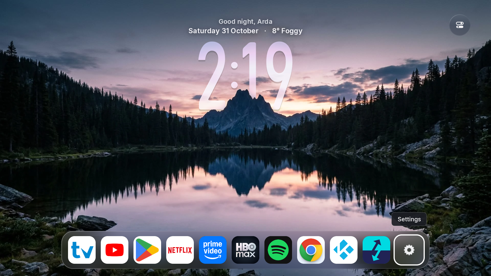
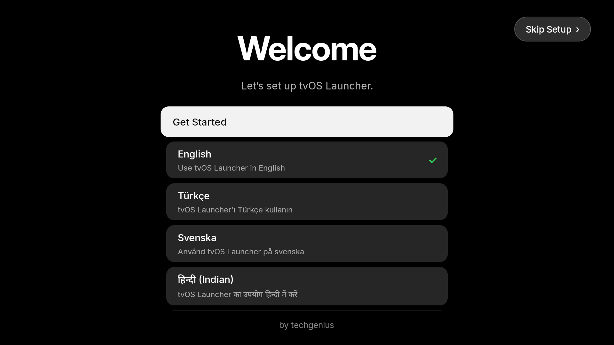
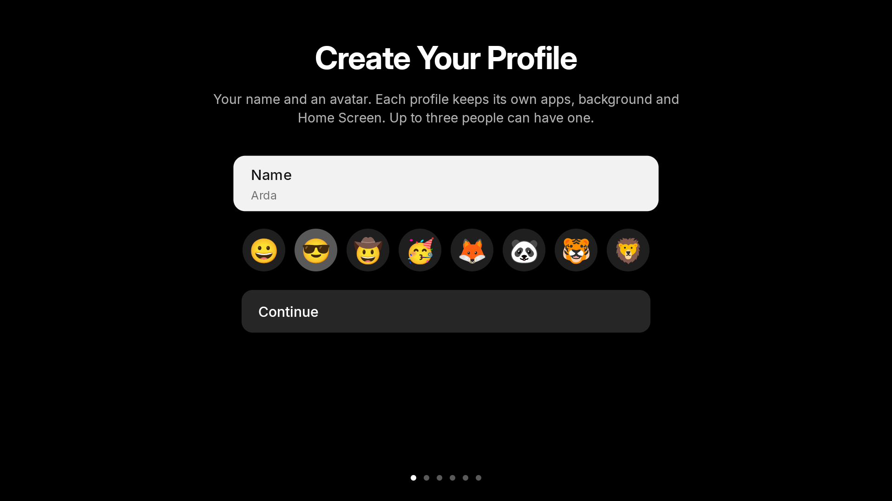
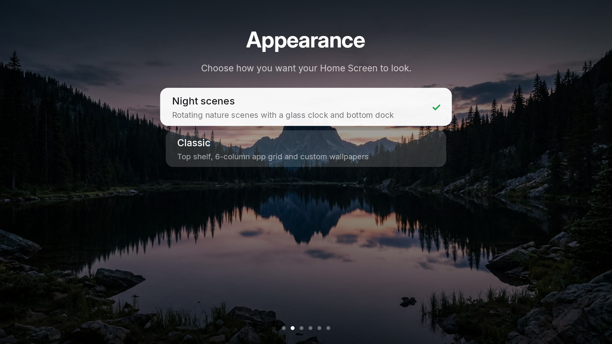
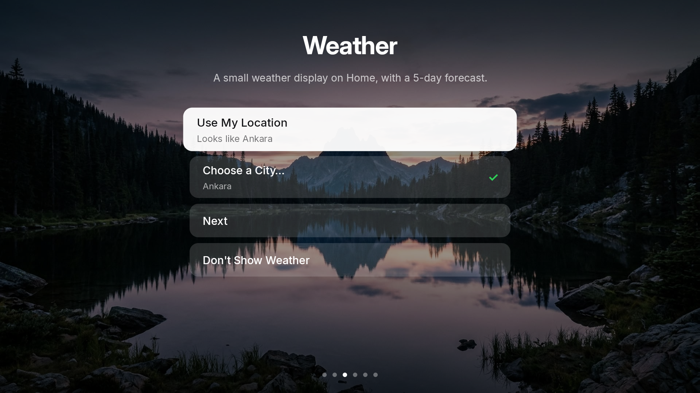
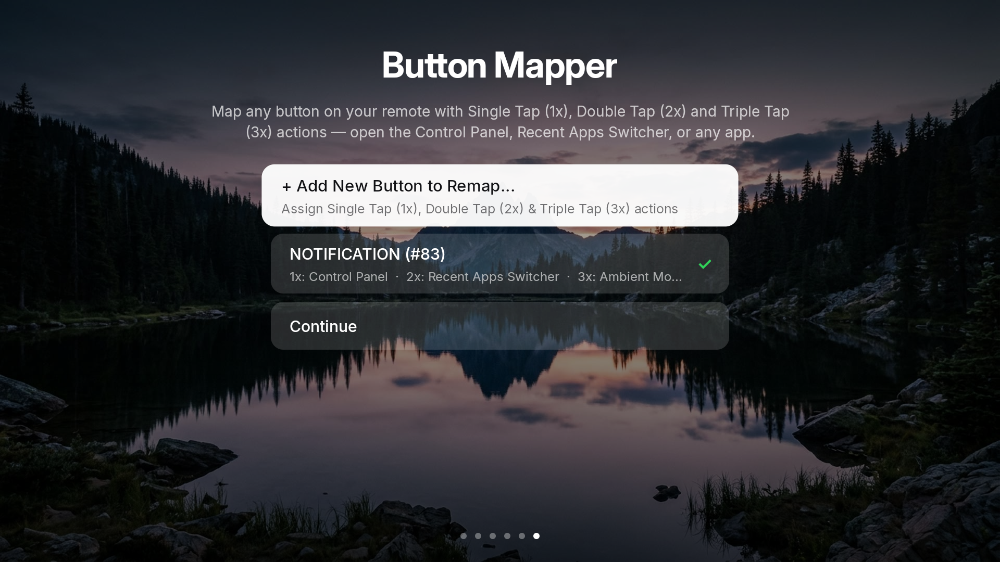
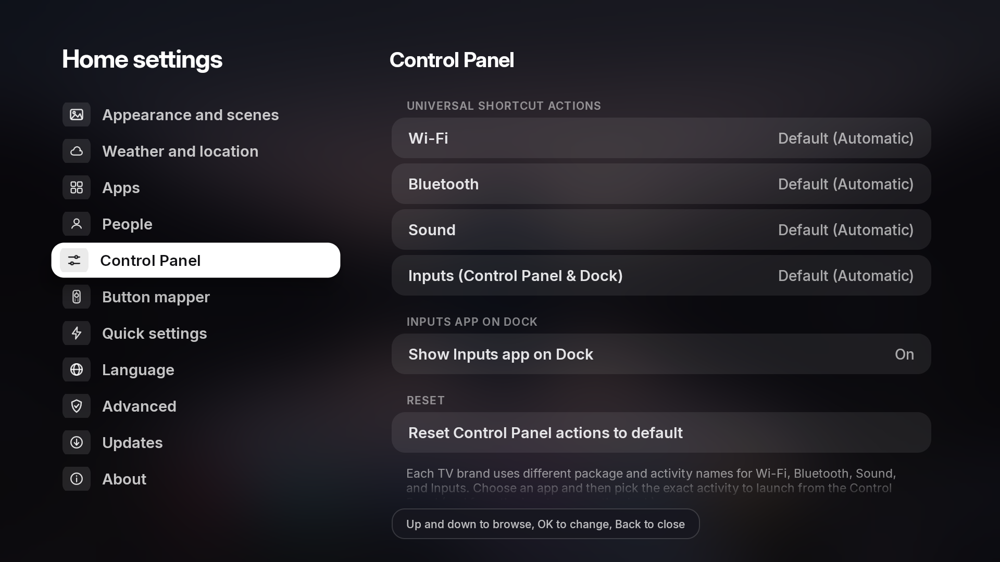
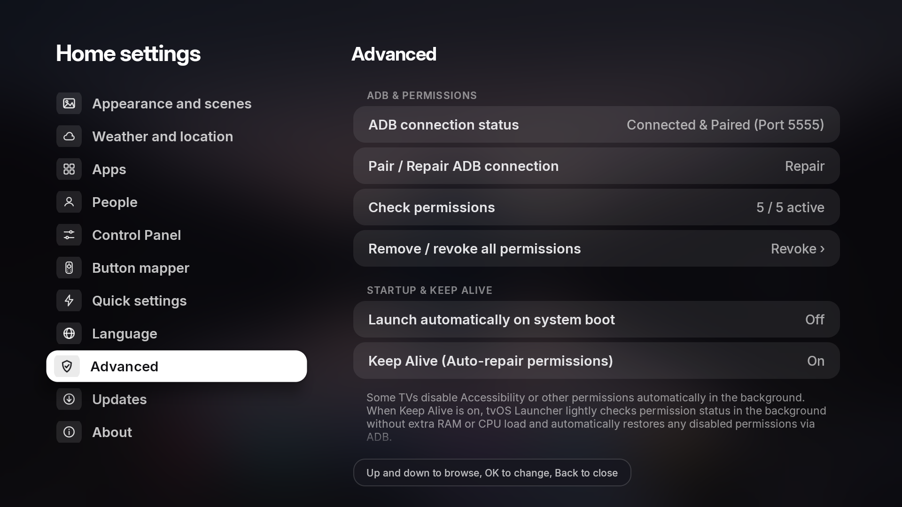
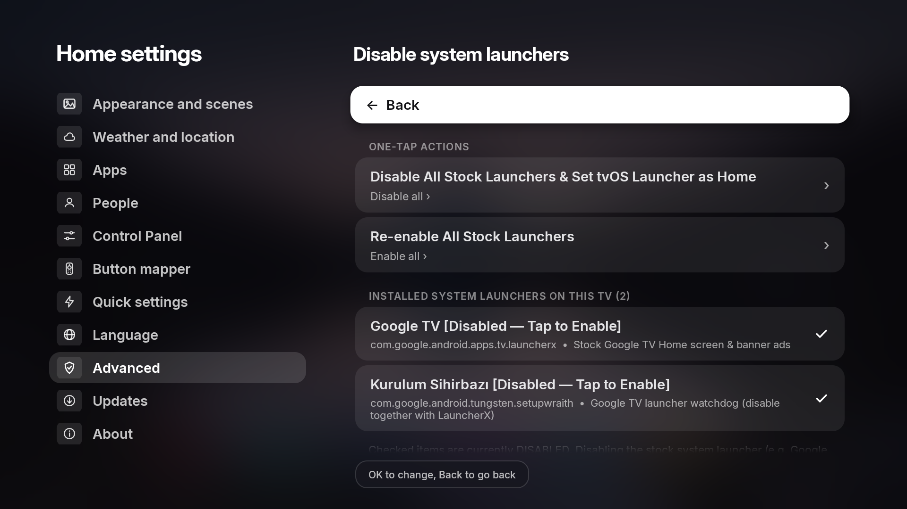
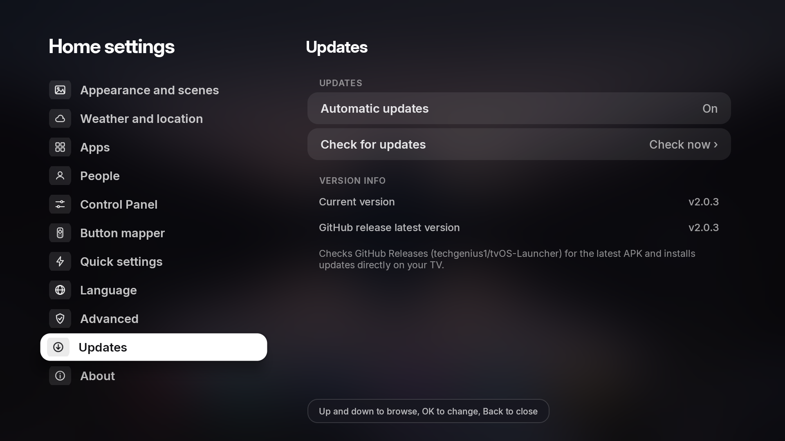

# tvOS Launcher на русском (`v2.2.5`)

> 🇷🇺 **Русская версия лаунчера.** Это форк проекта
> **[tvOS Launcher](https://github.com/techgenius1/tvOS-Launcher)** (автор — techgenius),
> в котором весь интерфейс и вся документация переведены на русский язык.
>
> 📦 **Скачать последний APK (`v2.2.5`):** **[GitHub Releases](https://github.com/disasdter/tvOS-Launcher-RUS-/releases/latest)**
> · 🌐 **Оригинальный проект:** **[techgenius1/tvOS-Launcher](https://github.com/techgenius1/tvOS-Launcher)**


Быстрый и лёгкий домашний экран для Android TV и Google TV в стиле tvOS 26 и macOS, написанный
на чистом Java без сторонних runtime-зависимостей (**APK ~6 МБ, `0.0%` фонового CPU, отрисованный
Liquid Glass, навигация 60 FPS**). Рассчитан на плавную работу от **Android 6.0 (API 23)** до
**Android 14+** даже на ТВ-приставках с 1 ГБ ОЗУ, и приносит: **масштабируемый многорядный
Liquid Glass док (`50%–150%`, `1–3 ряда`)**, **всплывающее окно приложений в стиле macOS 26**,
**универсальный поиск в нативном Liquid Glass с ярлыком на домашнем экране**, сменяемые
**ночные сцены** с **вырезанием глубины переднего плана** и **большими стеклянными часами или
маленькими часами в шапке**, **7 интерактивных виджетов домашней панели** (с **выбором страны
и города для времени намаза + синхронизацией с погодой** и **выбором страны для новостей**),
**собственные обои (`одиночные/множественные, перемешивание папки и обои с Reddit`)**,
**встроенный экран блокировки / заставку бездействия**, **смену иконок приложений и интерактивный
редактор иконок**, **автоматические обновления приложения с GitHub**, **встроенный деблоатер
CleanYourTV без ПК (загрузка профилей с GitHub по запросу + ручная очистка системных приложений +
отключение штатного лаунчера)**, **настраиваемую стеклянную панель управления (`Быстрые
настройки`) с расширенной погодой и системным меню питания**, **менеджер входов (скрытие и
переименование ТВ-входов)**, **переключатель недавних приложений**, **переназначение кнопок
пульта с несколькими нажатиями (`1x / 2x / 3x`) с поддержкой ScanCode и исправлением кнопки
«Домой» при прямой загрузке**, **универсальное исправление удержания кнопок громкости в 3 режимах
(стандартный, проектор HY320, приставка Onn TV)**, **звуковые эффекты интерфейса Apple TV**,
**режим «Кофеин»** и **двухрежимную безопасную настройку локального ADB (с динамическим
определением порта)** на любом Android TV.

---

## ✨ Возможности

- **Универсальный поиск в нативном Liquid Glass и ярлык поиска на домашнем экране**
  - Переработанный **поиск** в центрированном модальном окне Liquid Glass в стиле macOS 26,
    оформленном как интерфейс *Другие приложения*, с голосовым вводом и поддержкой клавиатуры.
  - Фильтрует результаты **Фильмы и сериалы** по реально установленным стриминговым приложениям
    и активному региону, плюс быстрый запуск **Поиск в приложениях** и **результаты внутри
    приложений** от поисковых провайдеров установленных ТВ-приложений.
  - Отключаемая кнопка **ярлыка поиска** рядом с кнопками погоды и панели управления на домашнем
    экране (**Настройки → Домашняя панель / Быстрые и домой**).

- **Домашняя панель по умолчанию (7 интерактивных и настраиваемых виджетов)**
  - Показывает горизонтально прокручиваемый ряд из 7 плиток Liquid Glass с нативными
    подробными окнами Liquid Glass (все включены по умолчанию; **удерживайте OK** на любом
    виджете, чтобы **переместить** или **отключить** его прямо с домашнего экрана, а обработка
    кнопки «Домой» выполняется без мигания):
    - 🕌 **Время намаза**: расписание на день (Фаджр, восход, Зухр, Аср, Магриб, Иша), живой
      обратный отсчёт до следующего намаза, 10 методов расчёта и **выбор страны/города**
      (поиск по всему миру, 20 популярных городов или автоматическая **синхронизация с
      местоположением погоды**, заданным при первичной настройке или в настройках).
    - ⚽ **Интерактивные футбольные матчи**: предстоящие и идущие матчи во всех лигах и
      турнирах (Лига чемпионов, Лига Европы, Премьер-лига, Ла Лига, Серия A, Бундеслига,
      Лига 1, Суперлига Турции и т. д.) с вашими любимыми командами, двумя логотипами команд,
      счётом в реальном времени и просмотром матчей кнопками влево/вправо.
    - 🎬 **Самое популярное**: популярные и трендовые фильмы и сериалы с ведущих стриминговых
      платформ на основе JustWatch; по умолчанию синхронизируется с языком интерфейса, можно
      выбрать несколько стран вручную.
    - ⛅ **Погода**: текущая температура, состояние, название места, прогноз на сегодня и завтра.
    - 🏏 **Крикет в реальном времени**: счёт и статус международных и лиговых матчей по крикету.
    - 📰 **Новости**: подборка главных заголовков и топ-новостей с **выбором страны**
      (по умолчанию синхронизируется с языком интерфейса).
    - 🍿 **Топ фильмов и сериалов**: рекомендации самых высокооценённых фильмов и сериалов.
  - Полностью доступны и настраиваются как в **ночных сценах**, так и в **классическом виде**.

- **Два режима оформления (`Ночные сцены` и `Классика`) + многорядный док**
  - **Ночные сцены**: многослойные сцены с глубиной переднего и заднего плана (*Ночь*, *Золотой
    час*, *Уровень воды*, *Туман*, *Рассвет в тропическом лесу*) или собственные обои (включая
    **собственные PNG-вырезки глубины переднего плана**, чтобы огромные стеклянные часы
    оказывались за объектом переднего плана) с гигантскими стеклянными часами (*iPhone Duo*,
    *iPhone Rounded*, *Tall Glass*) или необязательными **маленькими часами** в шапке слева,
    персональным приветствием, датой, живой погодой, плавным переходом сцен в фоновом потоке и
    динамически масштабируемым **доком Liquid Glass в стиле macOS (`50%`–`150%`, `1–3 ряда`)**
    с supersampled сглаженными иконками-squircle, адаптивными белыми/чёрными кольцами фокуса и
    всегда видимыми подписями приложений.
  - **Всплывающее окно приложений в стиле macOS 26 (`Другие приложения`) и хранилище скрытых
    приложений**: отдельное модальное окно приложений из матового стекла с прокручиваемой сеткой
    из 5 столбцов. Удерживайте **OK** на приложении, чтобы **переименовать**, **сменить иконку**,
    **переместить**, **переместить в другие приложения** (док аккуратно уменьшается), **скрыть**
    (доступно в **Настройки → Приложения → Скрытые приложения**), посмотреть **информацию**,
    **удалить** или **сбросить раскладку**.
  - **Классический вид**: чистая сетка из 6 столбцов с центрированным стеклянным доком в стиле
    Apple tvOS, карточками-приложениями squircle, симметричными отступами и встроенными
    фотографическими или атмосферными фонами.
  - **Большие часы для классического вида**: добавляет аутентичные большие стеклянные часы,
    приветствие, дату и ярлык погоды справа сверху в стиле iOS/tvOS в классический режим по
    умолчанию (отключая мини-часы в шапке), с настраиваемым **выравниванием часов
    (`Слева / По центру / Справа`)**.
  - **Динамическое и настраиваемое выравнивание часов на обоях**: динамическое выравнивание для
    стандартных ночных сцен, которое подстраивается под каждые обои, плюс независимое
    выравнивание слева / по центру / справа для собственных обоев.

- **Расширенный движок собственных обоев (интервал `1–60 мин`)**
  - **Одиночные и множественные обои**: неограниченный выбор обоев из внутренней памяти или
    USB-накопителей, плюс необязательные собственные PNG-слои глубины переднего плана для ночных
    сцен.
  - **Перемешивание папки**: автоматически перебирает все обои в выбранной папке.
  - **Обои с Reddit**: загружает обои в высоком разрешении прямо из выбранных сабреддитов
    (например, `wallpapers`, `EarthPorn`) с настраиваемым интервалом автосмены (`1, 2, 3, 5, 10,
    15, 20, 25, 30 или 60 минут`) и мгновенным действием «Следующие обои».

- **Универсальное «Продолжить просмотр» для всех медиаприложений**
  - Поддерживает установленные медиаприложения (YouTube, SmartTube, Netflix, Prime Video,
    Disney+, Apple TV+, HBO Max, Stremio, Nuvio, Lampa и другие сторонние ТВ-приложения)
    через каналы EPG / Watch Next / Preview `TvContract` Android TV, отслеживание активных
    сессий `MediaSessionManager` и слушателей уведомлений.
  - **Фильтрация по приложению в фокусе дока**: полка показывает контент только того
    медиаприложения, которое сейчас в фокусе на доке.
  - **Встроенные всплывающие окна Stremio и Nuvio в доке**: окна прямо над плитками дока с
    локальным кэшем, входом по QR-коду и переключением нескольких профилей (включая привязку
    форков Nuvio).
  - **Прямые deep links**: нажатие на любую карточку «Продолжить просмотр» открывает
    конкретное видео или эпизод.

- **Отдельная панель ТВ-входов и менеджер входов (`Настройки → Панель управления → Входы`)**
  - Мгновенная панель переключения входов в стеклянном стиле, которую можно назначить на кнопку
    через Button Mapper или открыть из панели управления и дока.
  - **Менеджер входов**: скрывайте неиспользуемые ТВ/HDMI-входы или задавайте любые имена и
    подписи прямо в настройках.

- **Режим «Кофеин» (`Настройки → Дополнительно`)**
  - Блокирует режим простоя Android и не даёт автоматически включаться Ambient Mode / заставке
    Android TV, поэтому телевизор остаётся включённым во время долгих сессий или презентаций.

- **Универсальная стеклянная панель управления (`Быстрые настройки`), системное меню питания и
  звуки интерфейса Apple TV**
  - Открывается с домашнего экрана или **поверх любого запущенного приложения** через Button
    Mapper, с выбираемым **размытым** или **прозрачным** фоном.
  - Аутентичные **звуковые эффекты интерфейса Apple TV** (*Навигация*, *Клик*, *Назад*),
    включаются прямо из панели управления.
  - **Настраиваемая плитка питания**: выбор между **выключением экрана**, **системным меню
    питания** Android (через специальные возможности или долгое нажатие по ADB) и собственным
    действием.
  - **Расширенная панель погоды**: нижняя плитка погоды шириной в 4 столбца с текущим прогнозом
    и прогнозом на завтра (нажатие открывает полный прогноз на 5 дней).
  - Включает плитки **Wi-Fi**, **Bluetooth**, **ОЗУ / недавние приложения**, **Не беспокоить**,
    **Звук**, **Таймер сна**, **Ambient Mode**, **Питание / выключение экрана**, **Входы**,
    **Button Mapper**, **Настройки** и **Поиск**.

- **Переключатель недавних приложений и очистка ОЗУ**
  - Открывается из любого приложения по назначенной кнопке пульта или нажатием на плитку **ОЗУ**
    в панели управления.
  - Показывает использование памяти в реальном времени (`использовано / всего`), плавные
    горизонтальные карточки приложений, **ВВЕРХ** для принудительной остановки или закрытия
    отдельного приложения, кнопку **Закрыть все** и понятную подсказку, если безопасный режим ADB
    ограничивает список фоновых задач.

- **Переназначение кнопок пульта с несколькими нажатиями, различение ScanCode и исправление
  удержания громкости в 3 режимах**
  - Учитывающая прямую загрузку и устойчивая к сбоям служба специальных возможностей, которая
    перехватывает кнопки пульта с независимыми действиями для **одинарного (1x)**, **двойного
    (2x)** и **тройного (3x)** нажатия, плюс **отправка кода клавиши**.
  - **Поддержка аппаратных ScanCode и безопасность Bluetooth-пультов**: различает кнопки с
    одинаковым Android keyCode (например, *Источники* `scanCode 757` и *Настройки* `scanCode 641`
    на keyCode `#602` у телевизоров Philips), при этом стандартные кнопки геймпада и удержание
    D-Pad на клавиатуре проходят без изменений, не блокируя Bluetooth-пульты.
  - **Исправление кнопки «Домой» и мгновенный приоритет при загрузке**: перехватывает нажатия
    «Домой» и запускает tvOS Launcher сразу после загрузки/разблокировки (`directBootAware` +
    `USER_UNLOCKED`) без задержки OEM-лаунчера.
  - **Универсальное исправление удержания кнопок громкости**:
    - **Режим 1 (стандартный — по умолчанию)**: плавное повторение громкости (задержка `320 мс`,
      повтор `85 мс`) и мгновенная остановка (`<= 45 мс`) на телевизорах Android 9–14.
    - **Режим 2 (HY320 / проектор)**: наблюдатель за дампом Binder с обработкой ИК-импульсов,
      адаптированный для Magcubic HY320 и проекторов Android 9–12.
    - **Режим 3 (Onn TV Box)**: оптимизированная скорость повторения и мгновенное срабатывание
      при отпускании, специально для приставок Onn Google TV.

- **CleanYourTV (бета) — встроенный деблоатер Android TV без ПК и помощник удаления
  (`Настройки → Дополнительно`)**
  - Скачивает по запросу последний архив релиза **[CleanYourTV](https://github.com/Gathin23/cleanyourtv)**
    в `Download/cleanyourtv`, распаковывает профили очистки с всплывающим окном прогресса и
    позволяет удалить ненужные файлы моделей после выбора телевизора, чтобы экономить место.
  - **Умное определение модели OEM и сканер схожих пакетов по ADB**: автоматически определяет
    точные или похожие модели по свойствам оборудования либо сканирует установленные пакеты
    производителя.
  - **Отключение штатного лаунчера в одно нажатие и ручная очистка**: отключайте штатные
    лаунчеры (*Google TV Home / LauncherX, Android TV Home / Leanback, TCL, Philips, Xiaomi,
    Sony, Amlogic/Droidlogic*) с подтверждениями безопасности и восстановлением в одно нажатие.
  - **Безопасное удаление**: отдельный пункт **Удалить tvOS Launcher** в дополнительных
    настройках, который предлагает вернуть удалённые приложения и снова включить OEM-лаунчеры,
    корректно отзывает специальные разрешения и открывает системный экран удаления.

- **Резервное копирование и восстановление настроек (`Настройки → Система / О программе /
  Быстрые и домой`)**
  - Полная резервная копия настроек лаунчера, порядка дока, пользовательских имён приложений,
    иконок, переназначения кнопок и настроек сцен в
    `Download/tvos-launcher-settings.json`.

- **Смена иконок приложений и интерактивный редактор иконок (`JPG / PNG / ICO`)**
  - Удерживайте **OK** на приложении, чтобы выбрать любой файл `.jpg`, `.jpeg`, `.png` или
    Windows `.ico` из внутренней памяти или USB-накопителя, со встроенным **редактором иконок**
    на 14 цветов со скруглёнными углами (живой предпросмотр, автоматический подбор цвета краёв,
    масштабирование и панорамирование).

- **Автоматические и ручные обновления с GitHub (`Настройки → Обновления`)**
  - Скачивает обновления в `Download/tvOSLauncherUpdates` без повторной загрузки уже имеющихся
    файлов, устанавливает их без окон через локальный ADB (`pm install -r`) в режиме постоянного
    ADB или через системный PackageInstaller в безопасном режиме, и автоматически очищает папку
    обновлений при первом запуске после обновления.
  - **Обновления берутся из этого репозитория** —
    **[disasdter/tvOS-Launcher-RUS-](https://github.com/disasdter/tvOS-Launcher-RUS-)**, а не из оригинального проекта,
    поэтому вы получаете именно русские сборки.

- **Двухрежимная безопасная настройка локального ADB с динамическим определением порта**
  - Автоматически сканирует и подключается к активному локальному ADB-порту телевизора (`5555`,
    `5070`, `adb.tcp.port` или активные слушающие сокеты), используя одну постоянную пару
    RSA-ключей.
  - **Безопасный режим (по умолчанию и рекомендуется)**: выдаёт разрешения один раз и сразу
    закрывает сетевой ADB (`adb_enabled = 0`).
  - **Режим постоянного ADB**: оставляет сетевой ADB открытым для очистки во время работы,
    управления недавними приложениями и тихих фоновых автообновлений.

- **18 поддерживаемых языков (полная поддержка RTL для иврита и арабского)**
  - Полностью локализован на **английском, турецком, азербайджанском (Azərbaycan dili),
    шведском, хинди, испанском, французском, немецком, итальянском, русском, португальском,
    бразильском португальском (Português do Brasil), арабском, японском, китайском, корейском
    (한국어) и иврите (עברית)** с зеркалированием интерфейса справа налево для иврита и
    арабского.
  - **В этой сборке русский перевод полный**: переведены все строки интерфейса, включая
    динамические (счётчики, даты, время, склонения), а не только базовые подписи.

- **Многопользовательские профили и живая погода**
  - До 3 профилей, у каждого свой порядок приложений, скрытые приложения и список «Продолжить
    просмотр», плюс бесплатный прогноз погоды на 5 дней через Open-Meteo, MET Norway или
    wttr.in (API-ключ не нужен).

- **Максимальная лёгкость, скорость и поддержка старых Android TV (Android 6.0 – Android 14+)**
  - Чистый Java из Android SDK — без Gradle, без Kotlin runtime, без раздувания AndroidX.
    Отрисованные поверхности Liquid Glass, ленивое создание классического вида, обновление
    виджетов на месте, нажатия «Домой» без мигания и полная совместимость от **Android 6.0
    (API 23)** до прошивок **Android 14+**.

---

## 📸 Скриншоты

> Скриншоты взяты из оригинального проекта и показывают английский интерфейс; в этой сборке
> все экраны отображаются по-русски.

### Домашний экран, панель управления и переключатель недавних приложений

| Ночные сцены и стеклянный док macOS | Стеклянная панель управления |
| :---: | :---: |
|  |  |

| Переключатель недавних приложений и очистка ОЗУ |
| :---: |
|  |

---

### Помощник первичной настройки

| 1. Приветствие и выбор языка | 2. Профиль и аватар |
| :---: | :---: |
|  |  |

| 3. Режим оформления (`Ночные сцены` / `Классика`) | 4. Погода и местоположение |
| :---: | :---: |
|  |  |

| 5. Простая настройка (авто ADB) или разрешения вручную | 6. Настройка переназначения кнопок (`1x / 2x / 3x`) |
| :---: | :---: |
|  |  |

---

### Настройки лаунчера

| Вид и сцены (`размер дока 50%–150%`) | Панель управления (`Быстрые настройки`) |
| :---: | :---: |
|  |  |

| Переназначение кнопок (`1x / 2x / 3x` и исправление кнопки «Домой») | Дополнительно, состояние ADB и проверка разрешений (`5 / 5`) |
| :---: | :---: |
|  |  |

| CleanYourTV — отключение системных лаунчеров | Автоматические и ручные обновления с GitHub |
| :---: | :---: |
|  |  |

---

## 🚀 Быстрый старт (сборка и установка)

### Что нужно

- **JDK 17+** (`javac`, `jar`)
- **Android SDK** с `build-tools;34.0.0` и `platforms;android-34`

### Сборка в Windows (PowerShell)

```powershell
powershell -ExecutionPolicy Bypass -File .\build.ps1
# APK -> build\tvos-home.apk
```

### Сборка в macOS / Linux

```sh
./build.sh
# APK -> build/tvos-home.apk
```

### Установка через ADB

```sh
adb connect <ip-тв>:5555
adb install -r build/tvos-home.apk
adb shell am start -n com.techgenius.tvoslauncher/.MainActivity
```

> **Важно:** сборка из этого репозитория подписывается локальным debug-ключом, который
> отличается от ключа официальных релизов. Если у вас уже установлена официальная сборка,
> сначала удалите её: `adb uninstall com.techgenius.tvoslauncher` (настройки при этом
> сбросятся), затем установите APK заново.

---

## 📚 Документация

| Документ | Описание |
|---|---|
| **[Начало работы](docs/getting-started.md)** | Установка инструментов SDK, сборка из исходников, запуск на Android TV или эмуляторе |
| **[Возможности](docs/features.md)** | Подробный разбор всех возможностей лаунчера |
| **[Установка и настройка](docs/install.md)** | Назначение домашним экраном, разрешения ADB и решение проблем |
| **[Режим презентации](docs/presentation.md)** | Отправка изображений, видео и веб-страниц из браузера |
| **[Архитектура](docs/architecture.md)** | Карта кода, сборочный конвейер без зависимостей и вопросы производительности |
| **[Перевод на русский](docs/translation.md)** | Что и как переведено, что оставлено терминами, как собрать русскую сборку |
| **[Участие в разработке](CONTRIBUTING.md)** | Процесс, стиль кода, правила дизайна и производительности |

---

## 📋 Требования

- **Android TV / Google TV 6.0+ (API 23+)**

---

## 🙌 Благодарности

Огромное спасибо open-source проектам, которые вдохновили **tvOS Launcher** и помогли ему
появиться:

- **[Hume Launcher](https://github.com/petrobot-admin/hume-launcher)** от
  [@petrobot-admin](https://github.com/petrobot-admin) — основа архитектуры Android TV на Java
  без зависимостей, классическая раскладка домашнего экрана и системные интеграции.
- **[Couch TV](https://github.com/Seagey/couch-tv)** от [@Seagey](https://github.com/Seagey) —
  дизайн и вдохновение для обоев с глубиной ночных сцен, гигантских стеклянных часов и
  стеклянного интерфейса настроек.
- **[CleanYourTV](https://github.com/Gathin23/cleanyourtv)** от
  [@Gathin23](https://github.com/Gathin23) — созданные сообществом профили очистки Android TV /
  Google TV (`examples/`) и правила безопасности, на которых работает встроенный деблоатер
  CleanYourTV (бета).
- **Шрифт Inter** (SIL Open Font License 1.1) и **генератор QR-кодов Project Nayuki**
  (MIT License).
- Данные о погоде предоставлены **Open-Meteo**, **MET Norway** и **wttr.in**.

Русский перевод и этот форк: **[disasdter](https://github.com/disasdter)**.

---

## 📄 Лицензия

Распространяется по **Apache License 2.0** — подробности в файлах [LICENSE](LICENSE) и
[NOTICE](NOTICE). Оригинальный проект: **[techgenius1/tvOS-Launcher](https://github.com/techgenius1/tvOS-Launcher)**.
