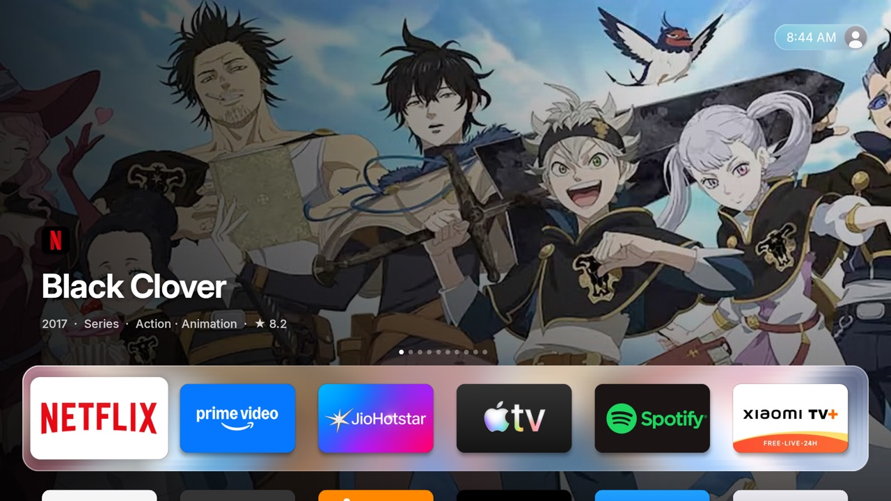
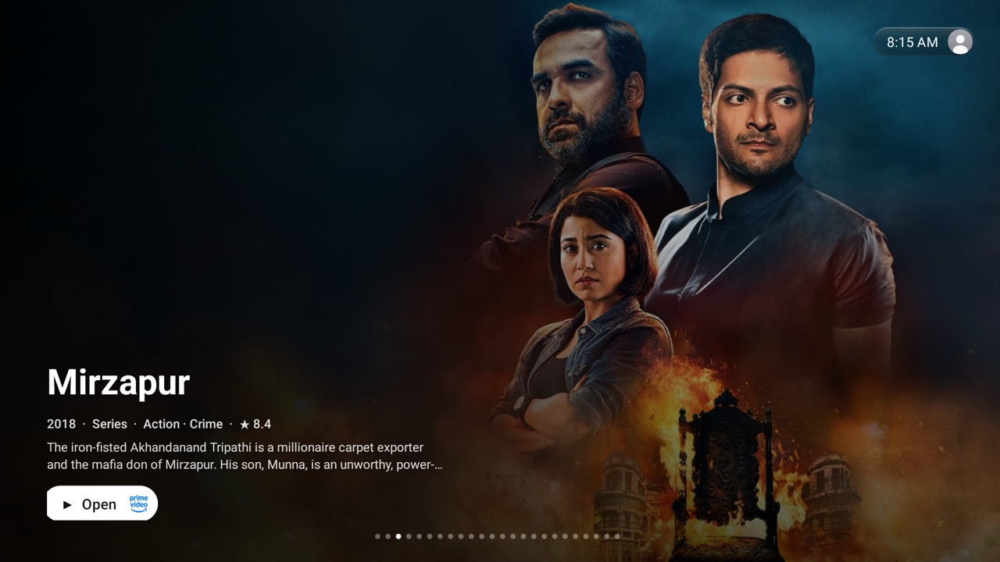
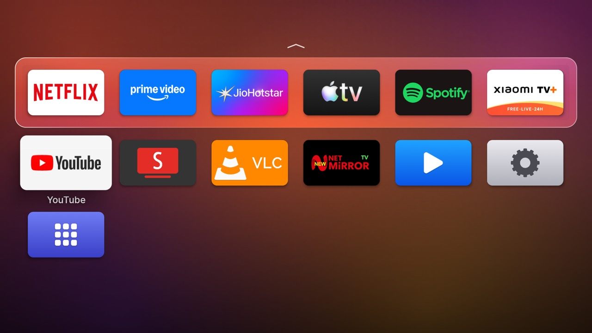
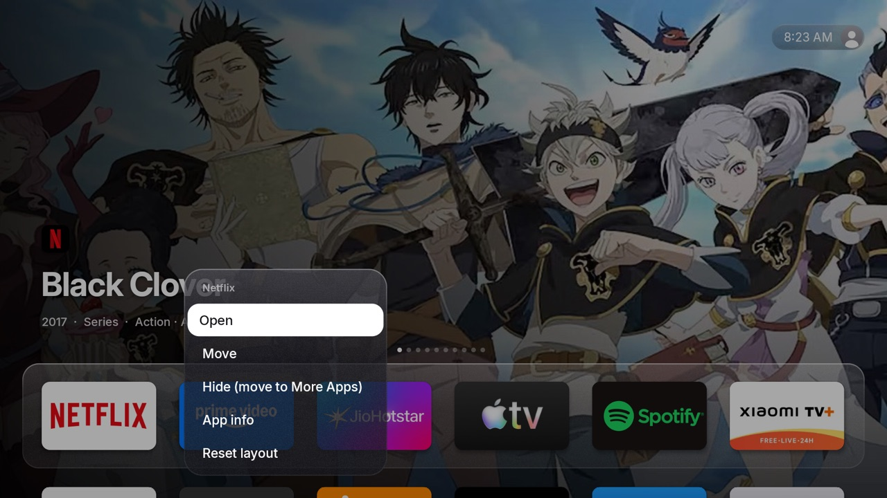

# Документация tvOS Launcher

> Русская версия документации. Оригинал:
> **[techgenius1/tvOS-Launcher](https://github.com/techgenius1/tvOS-Launcher)**.
> Форк с русским переводом: **[disasdter/tvOS-Launcher-RUS-](https://github.com/disasdter/tvOS-Launcher-RUS-)**.

tvOS Launcher (`com.techgenius.tvoslauncher`) заменяет домашний экран Android TV экраном,
сделанным по образцу Apple tvOS 26. Каждый элемент сверялся со скриншотами tvOS 26 от Apple и
Human Interface Guidelines, а затем настраивался так, чтобы работать в 60 fps на слабом GPU
Mali-450.

| | |
|---|---|
|  |  |
| Главный экран: рекомендации за стеклянным доком | Верхняя полка в фокусе: док уезжает вниз |
|  |  |
| Под доком: фон лаунчера | Меню параметров (удерживайте OK на приложении) |

## Содержание

- **[Начало работы](getting-started.md)** — установка инструментов, сборка, запуск на телевизоре
  или эмуляторе, ярлыки разработчика, решение проблем.
- **[Возможности](features.md)** — всё, что умеет tvOS Launcher: настройка, главный экран,
  карусель, погода, панель управления, профили, входы, поиск, заставка, защита AirPlay,
  настройки, разрешения.
- **[Установка и настройка](install.md)** — назначение домашним экраном, разовые разрешения,
  откат.
- **[Режим презентации](presentation.md)** — отправка контента из браузера, плеер на телевизоре,
  запуск при загрузке и веб-API.
- **[Архитектура](architecture.md)** — карта кода, сборка, проектные решения и заметки о
  производительности.
- **[Перевод на русский](translation.md)** — объём перевода, терминология, как собрать русскую
  сборку.
- **[Участие в разработке](../CONTRIBUTING.md)** — процесс, стиль кода, правила дизайна,
  производительности и разрешений, тестирование и pull request'ы.

## Кратко

| Область | Что делает |
|---|---|
| Док и сетка | Матовый док Liquid Glass; карточки 5:3, по 6 в ряду; увеличение в фокусе 1,2×; tvOS-анимация раскрытия |
| Карусель | Сначала «Продолжить просмотр», затем новости и сменяющиеся рекомендации (JustWatch, TMDB или Stremio); на весь экран при бездействии |
| Поиск | Приложения, настройки и входы мгновенно; фильмы и сериалы всех сервисов в Индии с «Открыть» / «Получить»; клавиатура хинди, диктовка; открывается удержанием «Назад» |
| Профили | До 3 профилей, уникальные эмодзи-аватары; отдельная раскладка, фон и история; выбор при пробуждении |
| Панель управления | Сон, Wi-Fi, «Не беспокоить», звук, таймер сна, Bluetooth, спец. возможности, настройки, поиск |
| Презентация | Загрузка изображений, видео и веб-страниц из браузера, зацикленное воспроизведение на весь экран, запуск при загрузке |
| Настройки | Отдельная страница на каждый раздел, открывается шестерёнкой в панели управления; страницы первичной настройки |
