# Возможности

Всё, что умеет tvOS Launcher, по областям. О том, как устроен код, см.
[architecture.md](architecture.md); о том, как собрать самому, — [getting-started.md](getting-started.md).

- [Первичная настройка](#первичная-настройка)
- [Главный экран](#главный-экран) · [Управление пультом](#управление-пультом)
- [Строка состояния](#строка-состояния) · [Поиск](#поиск) · [Карусель (верхняя полка)](#карусель-верхняя-полка) · [Полноэкранная карусель при бездействии](#полноэкранная-карусель-при-бездействии)
- [Погода](#погода) · [Панель управления](#панель-управления) · [Профили](#профили) · [Входы](#входы)
- [Режим презентации](#режим-презентации) · [Заставка](#заставка) · [AirPlay](#airplay-с-приложением-airplay-server)
- [Звуки навигации](#звуки-навигации) · [Настройки](#настройки) · [Разрешения](#разрешения) · [Масштабирование изображения](#масштабирование-изображения)

## Первичная настройка

При первом запуске tvOS Launcher проходит страницы в стиле Apple, по одному вопросу на каждой
(OK — дальше, «Назад» — назад):

1. **Приветствие** с плавной сменой языков Индии и мира, затем *Начать*.
2. **Создайте профиль**: имя и эмодзи-аватар.
3. **Выберите вид**: фон с живым предпросмотром за страницей.
4. **Ваш главный экран** (для этого профиля): рекомендации, новости и «Продолжить просмотр» —
   вкл/выкл.
5. **Погода**: использовать моё местоположение (показывает определённый город), выбрать город
   или не показывать погоду.
6. **Презентация** (для всего телевизора): использовать презентацию; если да — *Запускать вместе
   с телевизором* и *Не выключать экран*.
7. **Завершение настройки**: сразу появляется системный запрос местоположения Android; сделайте
   tvOS Launcher домашним экраном и разрешите всё остальное, что поддерживает телевизор (каждый
   пункт отмечается галочкой после выполнения; неподдерживаемые не показываются).
8. **Всё готово** → главный экран.

Настройки → Главная → **Пройти настройку снова** повторяет её. Если нажать «Домой» на середине,
настройка продолжится с того же места.

| | | |
|---|---|---|
| 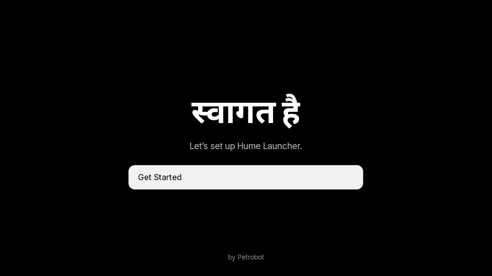 | 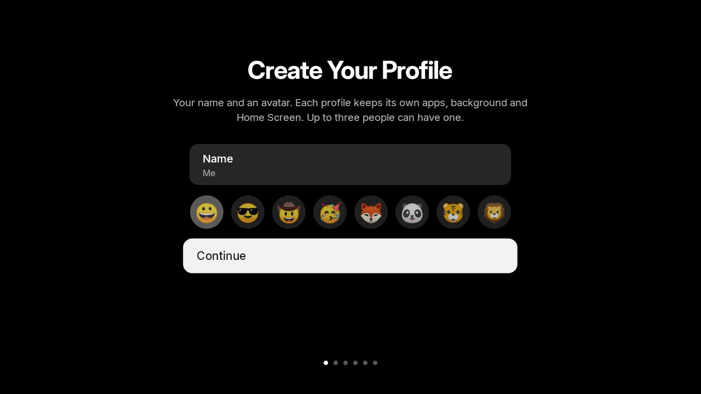 | 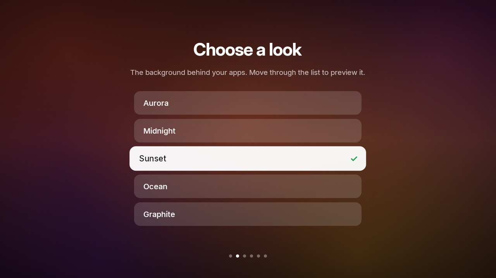 |
| 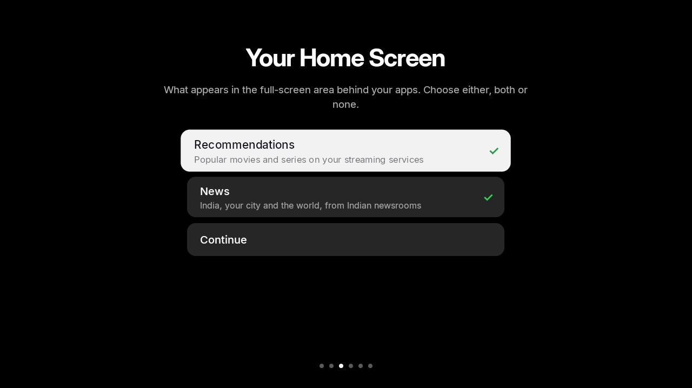 | 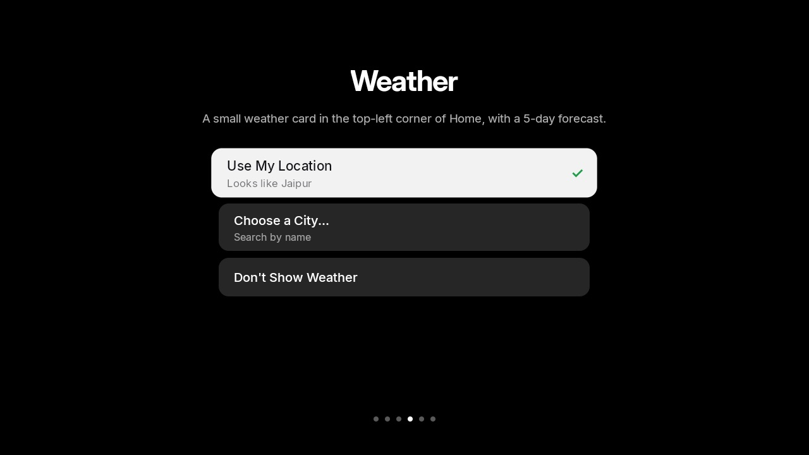 | 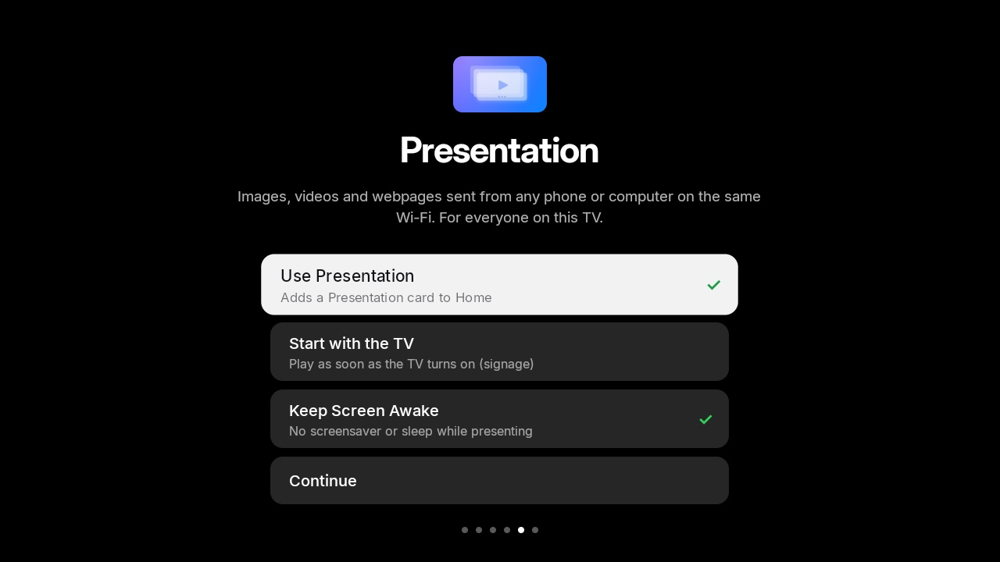 |
| 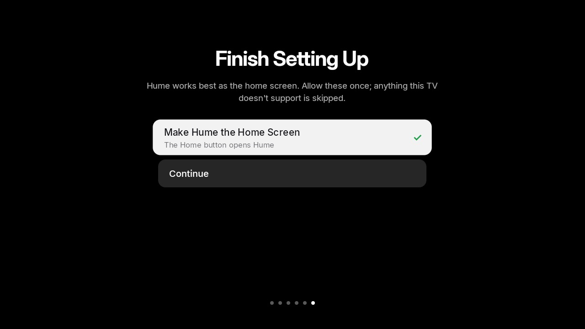 | 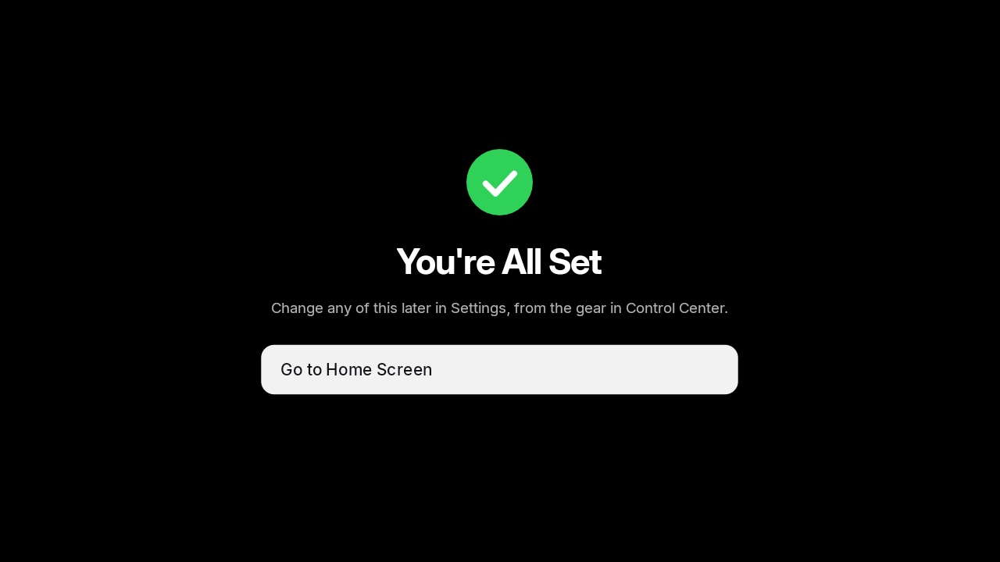 | |

## Главный экран

- **Док**: первый ряд приложений находится на матовой панели Liquid Glass (размытая копия того,
  что за ней, с усиленной насыщенностью, линзовыми краями и едва заметной каймой).
- **Сетка**: по 6 карточек в ряду в форме Apple 5:3; отступы, поля, радиусы углов и положение
  дока измерены по скриншотам Apple tvOS 26 и HIG (безопасная зона 60 pt / 80 pt).
- **Фокус**: карточка приподнимается до 1,2× с мягкой тенью и бликом; OK «вдавливает» карточку
  (нажатое состояние по HIG) и раскрывает её на весь экран, пока открывается приложение.
- **Названия** появляются под карточками в фокусе ниже дока (внутри дока их нет, как в tvOS).
- **Другие приложения**: скрытые приложения лежат в папке-карточке в конце сетки.
- **Системные приложения** (Настройки, Play Маркет…) получают карточки в стиле tvOS: градиент с
  белым глифом.
- **Фон**: Aurora, Midnight, Sunset, Ocean или Graphite (для каждого профиля свой).

### Управление пультом

| Где | Кнопка | Действие |
|---|---|---|
| Любая карточка | OK | Открыть (с анимацией раскрытия) |
| Любая карточка | Удержать OK / Меню | Параметры: открыть, переместить, скрыть, информация, удалить, сбросить раскладку |
| Режим перемещения | Стрелки / OK | Переместить «дрожащую» карточку / завершить |
| Док | Вверх | Карусель |
| Карусель | Влево / Вправо | Предыдущий / следующий элемент (по кругу) |
| Карусель (элемент «Продолжить просмотр») | Вправо | Переход от **Продолжить** к **Удалить** |
| Строка состояния | Влево / Вправо | VPN ⇄ Погода (если включена) ⇄ Обновить ⇄ Поиск ⇄ Панель управления ⇄ аватар |
| В любом месте главного экрана | Удержать «Назад» 1 секунду | Открывает поиск (короткое нажатие «Назад» работает как раньше) |
| В любом месте главного экрана | Кнопка поиска на пультах, где она есть | Открывает поиск и запускает диктовку |
| В любом месте главного экрана | Клавиатура: буква или цифра · `/` · Ctrl+F · Ctrl+K | Открывает поиск (с введённым символом) |
| Строка состояния | Вниз | Карусель (или док) |
| В любом месте | Домой | Закрывает любое окно и переходит к первому приложению в доке |
| Экран бездействия | Любая кнопка | Возвращает главный экран (нажатие не двигает фокус) |

## Строка состояния

Справа сверху, как в tvOS:

- **Индикатор интернета и время** на слабом тёмном чипе для контраста поверх ярких изображений.
  Индикатор нарисован как у Apple: полоски Wi-Fi по силе сигнала (или символ Ethernet), когда
  интернет работает; приглушённые полоски с **!**, когда сеть не может выйти в интернет;
  приглушённые полоски с чертой, когда сети нет.
- **VPN**: открывает системные настройки VPN; щит становится зелёным при активном VPN-подключении.
- **Обновить**: загружает новый набор рекомендаций и новостей, перезагружает «Продолжить
  просмотр» и принудительно обновляет погоду.
- **Поиск**, **панель управления** и **аватар профиля**.

Стеклянные элементы подстраиваются под то, что за ними: фон обесцвечивается, а оттенок темнеет
поверх ярких изображений и светлеет поверх тёмных, чтобы белый текст оставался читаемым.

## Поиск

Лупа рядом с панелью управления открывает поиск поверх размытого главного экрана, как в tvOS:
введённый текст сверху, однорядная клавиатура под ним, результаты ниже. Ярлыки: **удерживайте
«Назад»** на любом пульте, кнопка поиска на пультах, где она есть, или просто начните печатать
на клавиатуре. (Кнопку ассистента/микрофона на большинстве пультов Android TV забирает Google
Assistant раньше, чем её увидит приложение, поэтому она не может открыть поиск tvOS Launcher.)

- **Клавиатура**: a–z, пробел, удаление, **123** (цифры и знаки препинания), **अआ** (буквы
  хинди) и очистка. На иврите клавиатура начинается с букв иврита, а **abc** переключает на
  латиницу. USB/Bluetooth-клавиатура и цифровые кнопки пульта тоже вводят текст.
- **Диктовка**: **микрофон** рядом с полем поиска (вверх от клавиатуры) или кнопка
  поиска/микрофона пульта на главном экране либо в поиске. Там, где у телевизора есть голосовая
  служба Google, слова появляются в поле по мере речи, а результаты подтягиваются следом; микрофон
  запрашивается на экране при первом использовании. Esc на клавиатуре или «Назад» закрывает
  поиск. Без этого разрешения или службы слушает собственный голосовой запрос телевизора
  (Google).
- **До ввода**: недавние запросы (для каждого профиля) и то, что сейчас популярно в карусели.
- **Приложения и настройки** (мгновенно, без интернета): установленные приложения, включая
  скрытые, ТВ-входы («HDMI 2»), экраны tvOS Launcher (панель управления, погода, переключение
  профиля, настройки лаунчера) и настройки телевизора («wifi», «bluetooth», «заставка»…).
- **Фильмы и сериалы**: каждое название на любом стриминговом сервисе в Индии из JustWatch —
  включая фильмы на хинди и региональные, а запросы на хинди (पंचायत) работают — в виде постеров
  с логотипами сервисов, где они доступны. Если установлены Stremio или Nuvio, **В Stremio**
  добавляет названия, которые есть только в каталоге Stremio. Поиск выполняется, когда ввод
  приостанавливается; повторные запросы мгновенны.
- **Как смотреть**: OK на постере открывает страницу названия (изображение, год, жанры, рейтинг
  IMDb, описание) с кнопкой для каждого приложения: **▶ Открыть в …** для установленных
  приложений (сразу на нужном названии, где приложение это позволяет) и **Получить …** для
  остальных (страница приложения в Play Маркете), каждая помечена *Подписка*, *Бесплатно*,
  *Бесплатно с рекламой*, *Аренда* или *Покупка*.
- **Любой сервис, без списка**: tvOS Launcher сам сопоставляет каждый сервис с его приложением —
  приложение, указанное в Android TV-ссылке сервиса, установленное приложение, открывающее сайт
  сервиса, или установленное приложение с тем же именем, — поэтому новые сервисы работают без
  обновления.
- Настройки → Главная → Поиск: отключить результаты «Фильмы и сериалы» или очистить недавние
  запросы. Запросы уходят только в JustWatch (и в каталог Stremio, если установлены
  Stremio/Nuvio); ничего не логируется.

| | |
|---|---|
| 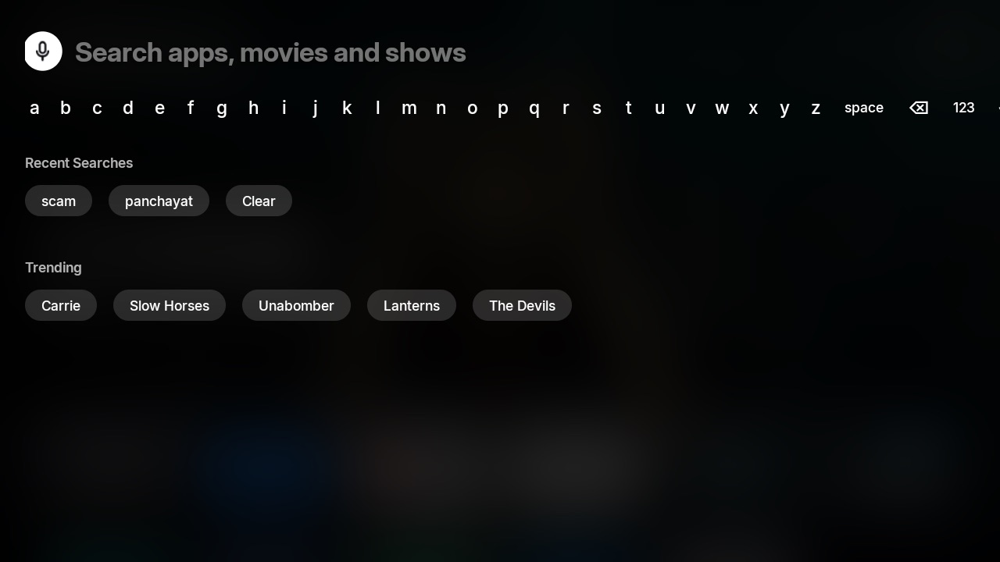 | 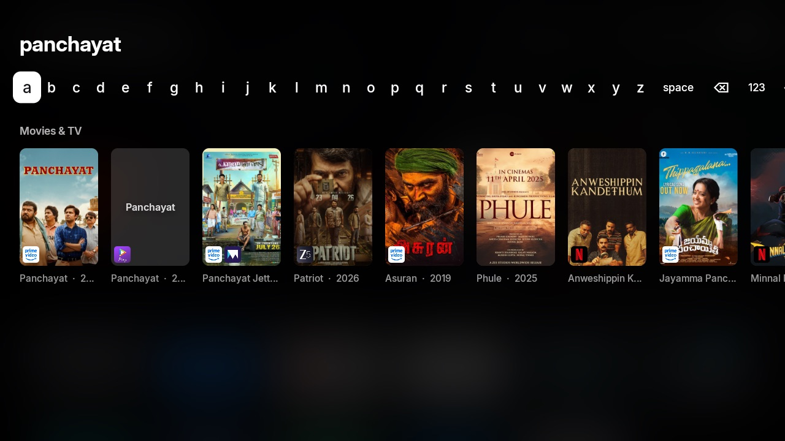 |
| 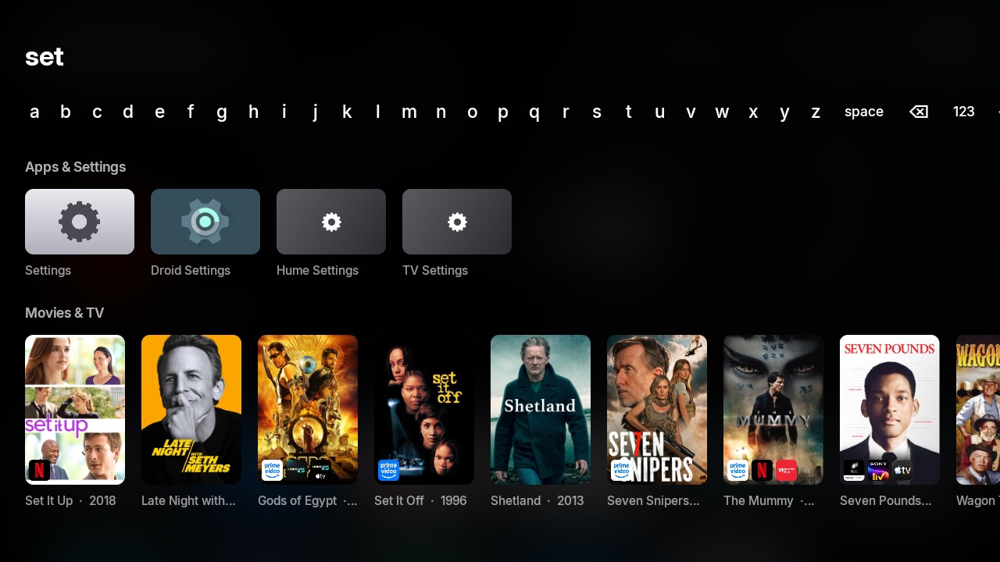 | 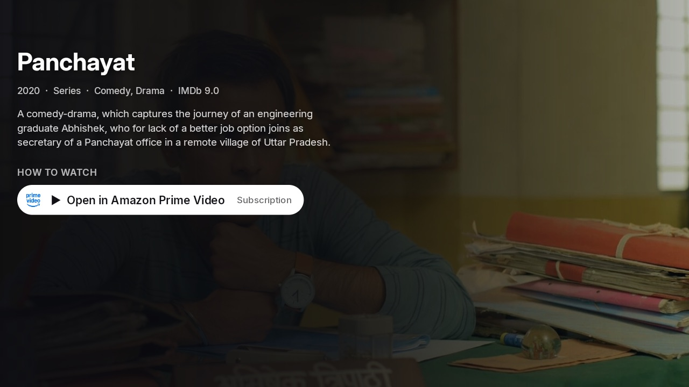 |
|  | 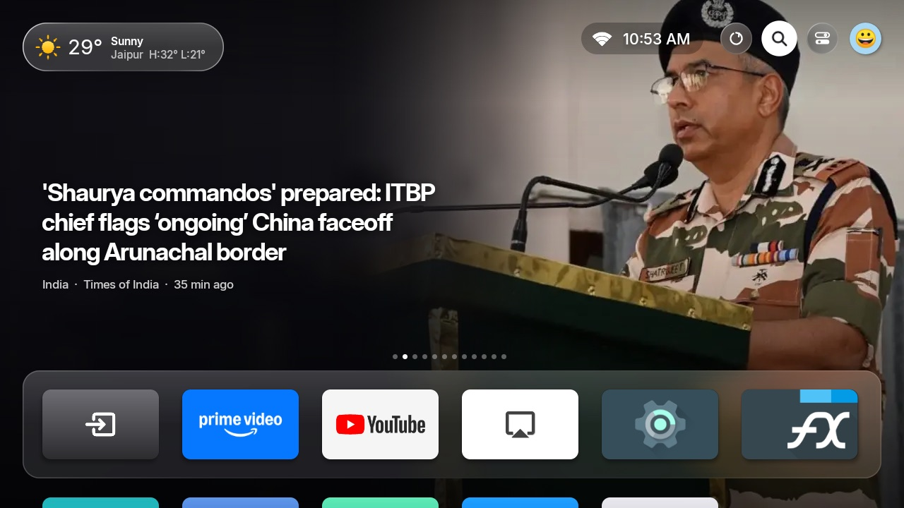 |

## Карусель (верхняя полка)

Полноэкранное изображение за доком, пока в фокусе находится приложение из дока. В одной карусели
по порядку:

1. **Продолжить просмотр** (до шести): что вы недавно смотрели в каждом приложении, из
   информации «сейчас воспроизводится», которую публикуют приложения (название, изображение,
   позиция, оставшееся время). **▶ Продолжить** открывает приложение; **✕ Удалить** убирает
   элемент. Названия, которые не смотрели повторно **7 дней**, истекают.
2. **Новости** и **рекомендации**, чередуясь.

- **Рекомендации**: популярные названия в Индии на ваших сервисах. Источник **JustWatch** (без
  ключа, неофициальный API) или **TMDB** (бесплатный ключ). При каждом обновлении случайно
  выбирается из топ-20 каждого сервиса, поэтому набор меняется в течение дня (каждые 2 часа или
  по кнопке «Обновить»). **▶ Открыть** переходит на страницу названия в приложении.
- **Stremio** как источник: популярные фильмы и сериалы Cinemeta (без ключа). **▶ Открыть**
  переходит на страницу названия в **Stremio** или в
  **[Nuvio](https://github.com/NuvioMedia/NuvioTV)**, если установлен только Nuvio; **Получить**
  открывает Stremio в Play Маркете. Настройки → Верхняя полка → Источник; при выборе Stremio
  пункт *Открывается в* показывает, какое приложение будет использовано.

  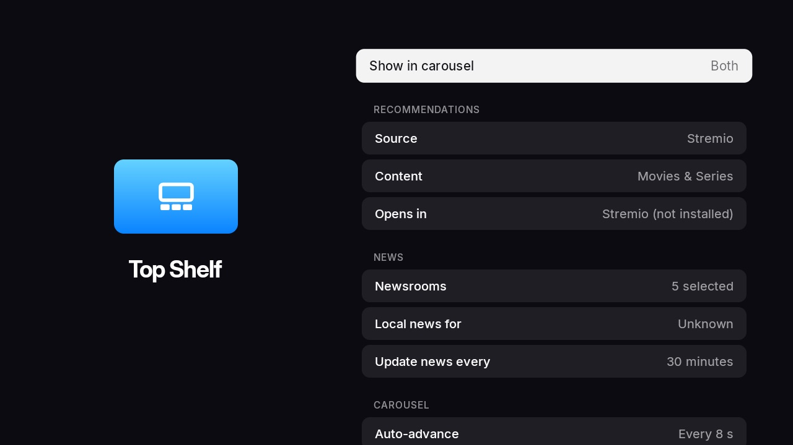
- **Новости**: Индия, локальные (ваш город по местоположению погоды) и мировые, из RSS-лент
  индийских редакций с большими изображениями: Times of India, Hindustan Times, The Indian
  Express, India Today и News18 по умолчанию (NDTV и The Hindu — по желанию). Редакционная
  вёрстка для чтения: заголовок, краткое содержание, раздел, издание и давность; без кнопки.
  Обновление каждые 30 минут (15/30/60).
- Каждый профиль выбирает, что показывать (Настройки → Верхняя полка / Продолжить просмотр или
  при настройке).

## Полноэкранная карусель при бездействии

Через 20 секунд без ввода на главном экране (Настройки → Главная: выкл., 10, 20, 30 или 60 с)
док и сетка уезжают вниз, плитка погоды исчезает, а карусель продолжает играть на весь экран с
названием и описанием внизу. Первое нажатие кнопки только возвращает главный экран.

## Погода

- Небольшая стеклянная **плитка погоды** в левом верхнем углу: иконка, температура, состояние,
  город и максимум/минимум на сегодня. OK открывает прогноз: текущие условия, влажность и ветер,
  следующие шесть часов и список на 5 дней с полосами диапазона температур (синий → красный,
  точка — «сейчас»), как в Apple Weather.
- Бесплатные источники без ключа: [Open-Meteo](https://open-meteo.com) (по умолчанию),
  [MET Norway](https://api.met.no) и [wttr.in](https://wttr.in); выбранный первым, остальные как
  запасные. Панель показывает, какой источник ответил и когда.
- Обновление каждые **15 минут** по умолчанию (10/15/30/60) и при возвращении интернета.
  Последний прогноз кэшируется, поэтому показывается мгновенно и офлайн.
- Местоположение по IP-адресу (ipapi.co → ipwho.is → geojs.io), если город не выбран вручную.

## Панель управления

Открывается кнопкой рядом со временем; весь главный экран за ней размывается. Плитка в фокусе
становится сплошной белой.

| Плитка | Что делает |
|---|---|
| Выключение | Переводит телевизор в сон (см. [Разрешения](#разрешения)) |
| Память | Полоса использования; OK закрывает приложения, открытые с главного экрана после последней очистки |
| Wi-Fi | Имя сети; открывает настройки Wi-Fi |
| Не беспокоить | Вкл / выкл |
| Звук | Текущий выход; открывает настройки звука |
| Таймер сна | Выкл → 15 → 30 → 60 → 90 мин |
| Круглые ярлыки | Входы (на телевизорах со входами; иначе спец. возможности), Bluetooth/геймпады, настройки, поиск |

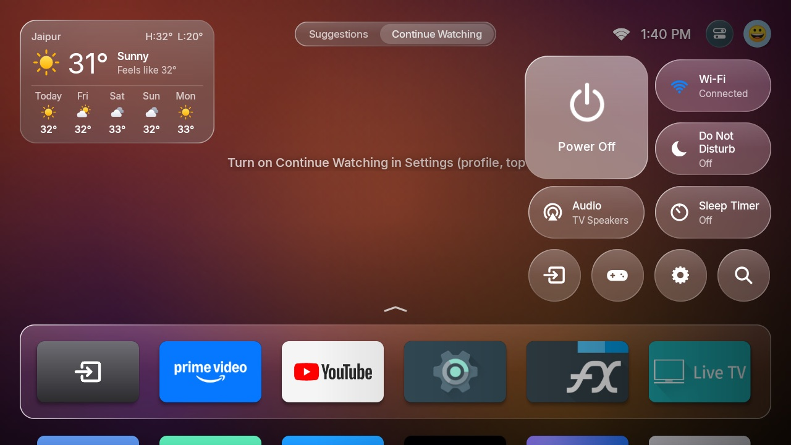

## Профили

- До **3 профилей**, у каждого **уникальный эмодзи** на пастельном круге.
- Каждый хранит свою раскладку приложений и скрытые приложения, фон, выбор карусели и
  «Продолжить просмотр».
- Аватар открывает полноэкранный переключатель **Кто смотрит?** с крупными аватарами по центру
  поверх размытого главного экрана и пунктом **+ Добавить пользователя**. Долгое нажатие OK (или
  Меню) на профиле: переименовать, сменить эмодзи, сменить цвет, удалить.
- При двух и более профилях переключатель может появляться при пробуждении телевизора
  (Настройки → Профили).

## Входы

Только на телевизорах с аппаратными входами (HDMI, AV, компонентный, тюнер): карточка **Входы**
идёт первой в доке, а ярлык входов находится в панели управления. Выбор показывает каждый вход с
иконкой разъёма (HDMI, AV, компонентный, S-Video, VGA/DVI, DisplayPort, SCART, USB, антенна);
подключённый USB-накопитель тоже появляется. Источники каналов приложений (например, Mi TV+) не
являются входами. Карточку можно переместить, скрыть или отключить (Настройки → Входы).

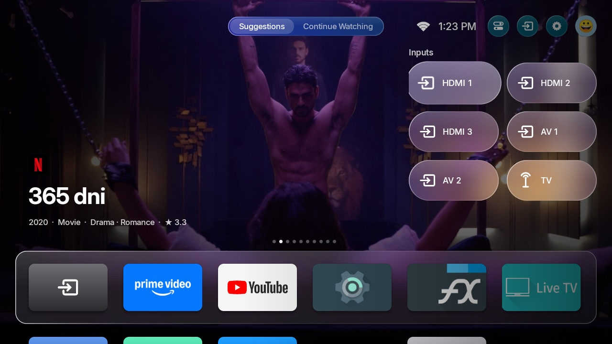

## Режим презентации

Отправляйте изображения, видео и веб-страницы из любого браузера в той же сети Wi-Fi и
воспроизводите их на весь экран в цикле, при желании запуская вместе с телевизором (digital
signage). См. **[presentation.md](presentation.md)**.

## Заставка

tvOS Launcher никогда не удерживает экран включённым, поэтому собственная заставка телевизора
(например, Aerial Views) включается по его таймауту. Настройки → Главная → **Заставка на главном
экране**: *Системная заставка* (по умолчанию) или *Полноэкранная карусель tvOS Launcher*, которая
держит экран включённым и позволяет карусели играть вместо заставки. Там же можно показать
заставку телевизора (открыть её настройки или приложение) и **Запустить заставку сейчас**.

## AirPlay (с приложением AirPlay Server)

Android TV сам по себе не принимает AirPlay. Установите бесплатное open-source приложение
**[AirPlay Server](https://github.com/jqssun/android-airplay-server)** (`io.github.jqssun.airplay`,
GPL-3.0), и телевизор появится в AirPlay на Mac, iPhone и iPad для зеркалирования экрана, видео и
звука. Как настроить — см. [install.md](install.md#необязательно-приёмник-airplay). В tvOS
Launcher оно выглядит как любое другое приложение.

**Защита AirPlay** (автоматически, только если это приложение установлено): после долгого сна
приложение AirPlay может продолжать работать, не объявляя себя, поэтому телевизор исчезает из
списков AirPlay. При пробуждении, возвращении сети и каждые 15 минут на главном экране tvOS
Launcher спрашивает сеть (mDNS-запрос, как это делает Mac), виден ли приёмник; если нет — он
перезапускает сервер приёмника через его settings receiver или запускает остановленное приложение
через его start-up receiver. На экране ничего не появляется. Имя приёмника задаётся в приложении
AirPlay (например, «Mi Box»).

## Звуки навигации

Собственные системные звуки Android TV: звук фокуса на каждое направление D-Pad и щелчок нажатия
при выборе и «Назад», на 60 % обычной громкости. Настройки → Главная → Звуки навигации.

## Настройки

Открываются шестерёнкой в панели управления. Главный список открывает страницу на каждый раздел
(«Назад» возвращает): профили, верхняя полка, презентация, входы, погода, «Продолжить просмотр»,
главная, разрешения, о приложении и собственные настройки телевизора.

**Язык**: 18 языков, включая иврит и русский. На иврите настройки, первичная настройка, диалоги и
веб-страница презентации зеркалятся справа налево; главный экран сохраняет свою раскладку
(порядок дока, положение часов) и показывает текст справа налево. Направление чтения следует
языку приложения, а не системному языку телевизора.

> **Русский язык в этой сборке.** Выберите **Настройки → Язык → Русский**. Переведены все строки
> интерфейса — включая динамические (счётчики, даты, время, склонения), а не только статические
> подписи. Подробности: [translation.md](translation.md).

| | |
|---|---|
| 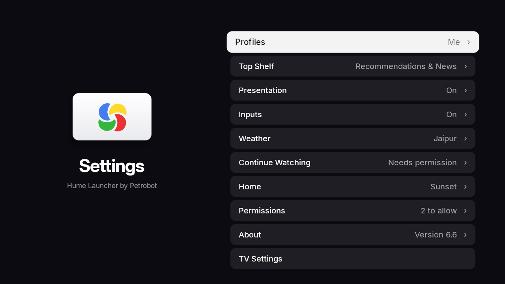 | 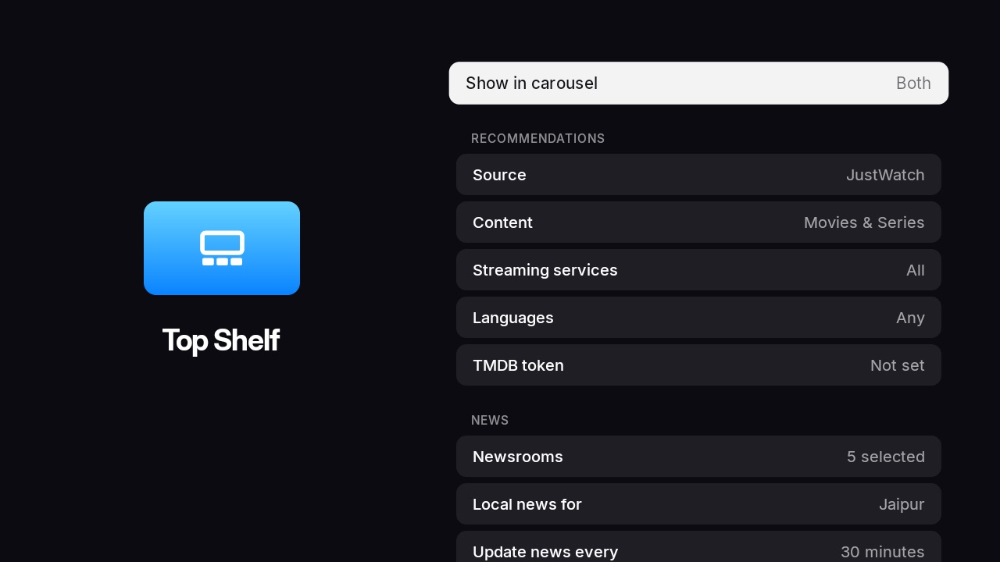 |

## Разрешения

tvOS Launcher спрашивает на экране везде, где телевизор это позволяет; adb — только крайняя мера.

| Возможность | Как выдаётся |
|---|---|
| Имя Wi-Fi (местоположение) | Системный запрос разрешения Android |
| «Продолжить просмотр» и «Не беспокоить» | Системный экран доступа к уведомлениям. Невозможно на телевизорах с малым объёмом ОЗУ (1 ГБ), где Android это отключает — tvOS Launcher сообщает об этом |
| Выключение и таймер сна | Системный экран Android «Активировать приложение администрирования устройства?»; там, где администрирование устройства отключено (например, Mi Box), — переключатель специальных возможностей tvOS Launcher **tvOS Launcher – выключение** в настройках спец. возможностей телевизора (открывается автоматически). Тот же переключатель позволяет «Очистке» закрывать приложения |
| Диктовка в поиске (микрофон) | Системный запрос разрешения Android при первом использовании микрофона; без него используется голосовой запрос телевизора |
| Домашний экран | Системный запрос Android 10+ «приложение по умолчанию для главного экрана», настройки домашнего приложения телевизора или системный выбор; tvOS Launcher предлагает это один раз, если дома другой лаунчер |

Только если у телевизора нет ни одного из этих экранов, показывается разовая команда adb.

## Масштабирование изображения

Все размеры относительны разрешению экрана (расчётная сетка 960×540), поэтому раскладка сохраняет
пропорции на 720p, 1080p и 4K и перестраивается при изменении дисплея.
