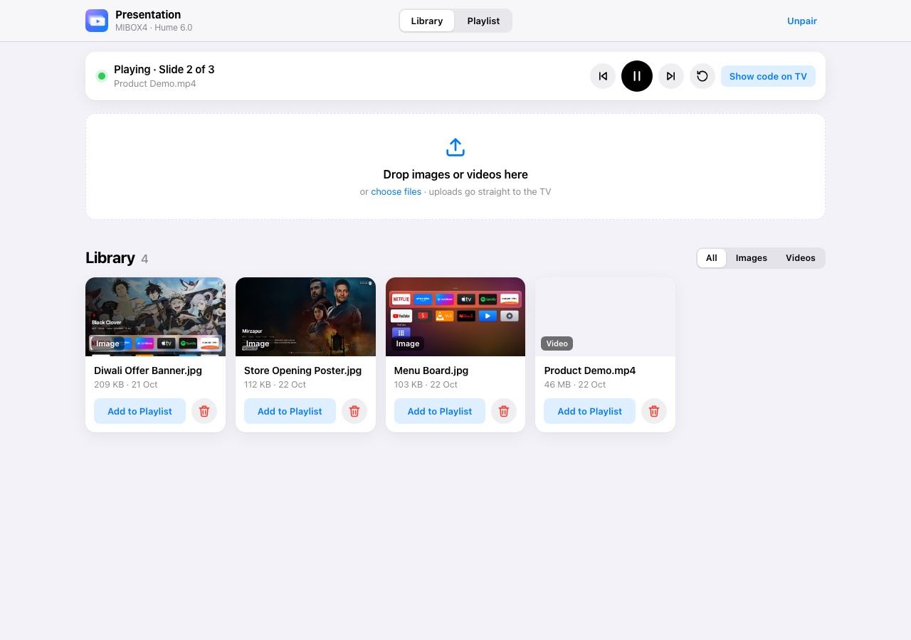
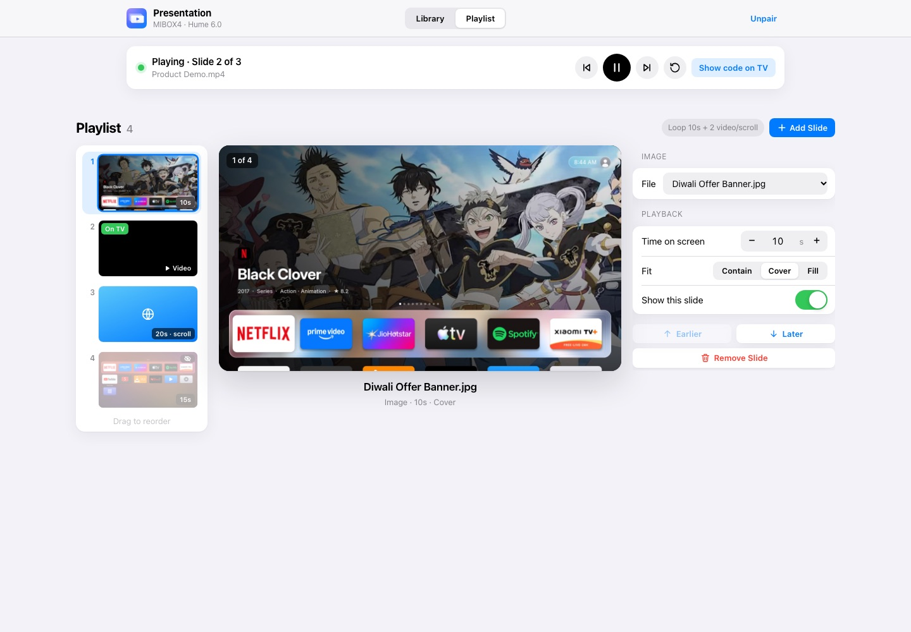
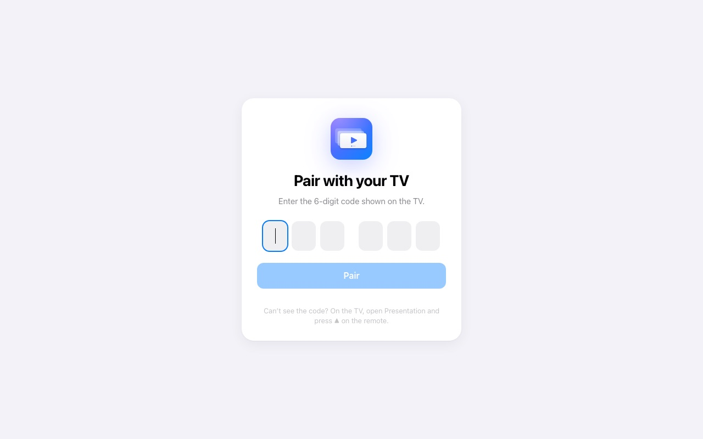
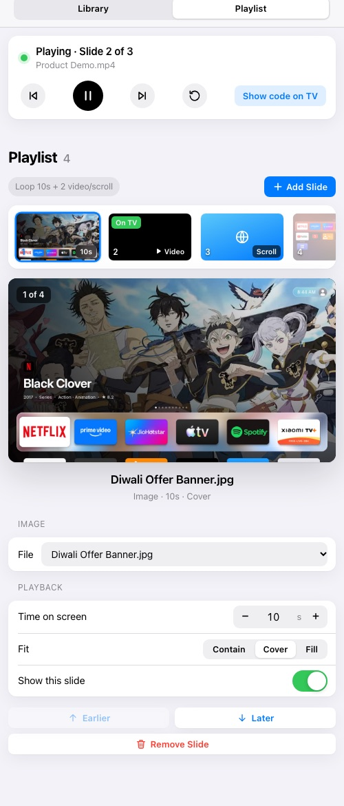
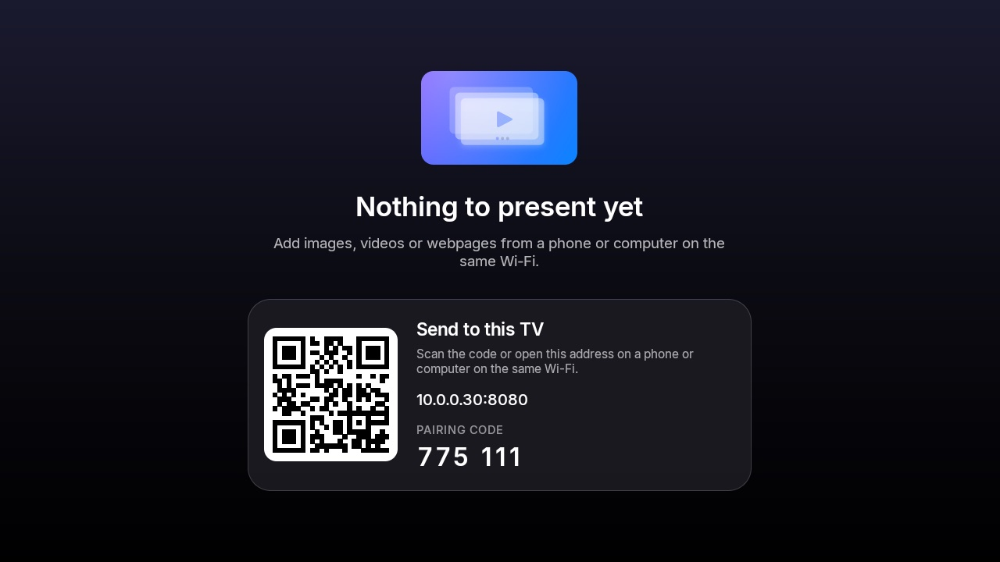

# Режим презентации

Презентация превращает телевизор в информационный экран (digital signage), которым вы управляете
из любого браузера в той же сети. Загружайте изображения и видео, добавляйте веб-страницы,
выстраивайте их в плейлист — и телевизор зацикленно проигрывает его на весь экран. Это встроенная
возможность tvOS Launcher, перенесённая из **PB Marketer TV** (`pb-marketer-tv`) с той же логикой
воспроизведения и веб-API.

**Убрано из оригинала** (по запросу): PIN-блокировка админки и загрузки, отладочная панель
телеметрии и самообновление APK. **Оставлено:** сопряжение браузера по 6-значному коду,
показываемому на телевизоре.

| | |
|---|---|
|  |  |
| Библиотека: загрузка перетаскиванием, миниатюры | Плейлист: навигатор слайдов, живой предпросмотр, настройки |
|  |  |
| Сопряжение по коду с телевизора | На телефоне |

## Включение

Настройки → **Презентация**:

| Настройка | Что делает |
|---|---|
| Режим презентации | Запускает веб-сервер на порту 8080 и добавляет плитку **Презентация** на главный экран |
| Запускать при загрузке | Открывает презентацию на весь экран сразу после включения телевизора |
| Не выключать экран | Не даёт телевизору заснуть или включить заставку во время презентации |
| Адрес и код сопряжения | Показывает адрес, QR-код и код сопряжения |
| Запустить презентацию сейчас | Открывает презентацию на весь экран |

Адрес, QR-код и код сопряжения всегда показываются на несколько секунд при старте презентации.

## Отправка контента из браузера

1. На телефоне или компьютере в той же сети Wi-Fi откройте адрес (например,
   `http://192.168.1.13:8080`) или отсканируйте QR-код.
2. Введите **код сопряжения**, показанный на телевизоре (один раз на браузер; код меняется при
   перезапуске телевизора).
3. **Библиотека**: перетащите изображения или видео в область загрузки (можно несколько сразу);
   у каждого будет своя полоса прогресса. Фильтр «Все / Изображения / Видео»; удаление с
   подтверждением.
4. **Плейлист** работает как редактор слайдов: миниатюры всех слайдов слева (на телефонах —
   полоса сверху), крупный предпросмотр выбранного слайда в центре и его настройки справа.
   - **Добавить слайд** → *Из библиотеки…* или *Веб-страницу…*.
   - Перетаскивайте миниатюры для изменения порядка (или используйте *Раньше* / *Позже*, либо
     Alt+↑/↓). ↑/↓ переключают слайды.
   - Настройки: файл или адрес, время на экране, вписывание (Contain / Cover / Fill, видно сразу
     в предпросмотре), звук для видео, скорость автопрокрутки и пауза для веб-страниц, а также
     *Показывать этот слайд*.
   - Слайд, который сейчас на телевизоре, помечен **На ТВ**; скрытые слайды приглушены.
5. **Сохранить на ТВ** — панель сохранения появляется всякий раз, когда есть несохранённые
   изменения (с кнопкой *Отменить*).
6. Панель **Сейчас играет** показывает, что на телевизоре, и содержит кнопки «предыдущий /
   пауза-воспроизведение / следующий / начать заново», а также *Показать код на ТВ*.

Страница следует светлому или тёмному режиму устройства и работает на телефонах.

## На телевизоре

| Кнопка пульта | Действие |
|---|---|
| ◀ / ▶ | Предыдущий / следующий слайд |
| OK | Пауза / воспроизведение |
| ▲ / ▼ / Info | Показать адрес, QR-код и код сопряжения |
| Назад, Назад | Выход на главный экран (нажать дважды) |

Правила воспроизведения (без изменений от оригинала):

- **Изображения** держатся заданное время (по умолчанию 10 с).
- **Видео** проигрываются до конца (по умолчанию без звука), затем переключается следующий слайд.
- **Веб-страницы** загружаются в десктопном вьюпорте шириной 1920 px, масштабированном под экран;
  с автопрокруткой они прокручиваются с заданной скоростью, останавливаясь примерно каждые 85 %
  экрана, затем переключается следующий слайд; без неё держатся заданное время (по умолчанию
  20 с). В старых WebView (до Chrome 99) правила CSS `@layer` разворачиваются, чтобы современные
  сайты отображались корректно.
- Слайд с ошибкой показывает сообщение и пропускается через 5 секунд.
- Без слайдов телевизор показывает один центрированный экран: иконку презентации, «Пока нечего
  показывать», QR-код, адрес и код сопряжения.

## Веб-API

Всем вызовам, кроме `/api/info` и `/api/pair`, нужен `Authorization: Bearer <token>` (или
`?token=` для URL медиафайлов). JSON на входе и выходе.

| Метод и путь | Описание |
|---|---|
| `GET /api/info` | Имя, устройство, порт, адреса админки, версия, `pairingRequired` |
| `POST /api/pair` `{pin}` | Обмен 6-значного кода с телевизора на `{token}` |
| `GET /api/media` | `{media: [...]}` — сначала новые |
| `POST /api/media` | Загрузка (multipart-поле `file`, необязательные `mimeType`/`originalName`; либо сырое тело с `X-File-Name`/`X-File-Type`) |
| `GET /api/media/{id}/file` | Сохранённый файл (используется для миниатюр) |
| `DELETE /api/media/{id}` | Удалить файл и все слайды, которые его используют |
| `GET /api/playlist` | `{playlist}` — единственный плейлист «Default» |
| `PUT /api/playlist` `{name, slides}` | Заменить слайды (с валидацией) |
| `GET /api/playback/status` | `{playback: {available, state, slideIndex, slideCount, mediaName, url, error, ...}}` |
| `POST /api/playback/control` `{command}` | `play`, `pause`, `next`, `previous`, `restart`, `showConnectionInfo` |

Для совместимости сохранены алиасы: `GET/POST /api/playlists`, `GET/PUT /api/playlists/{id}`,
`POST /api/playlists/{id}/activate`.

Поля слайда: `id, type (image|video|webpage), durationSec, mediaId, url, fitMode
(contain|cover|fill), muted, loop, webpageAutoScroll, webpageScrollSpeedPxPerSec (5–1000),
webpageScrollPauseSec (0–300), enabled, order`.

## Хранилище

Та же структура, что в оригинальном приложении, внутри приватного хранилища tvOS Launcher:
`signage.db` (таблицы `media`, `playlists`) и загруженные файлы в `files/media/<uuid>.<ext>`.
Загрузки пишутся на диск потоком, поэтому большие видео не занимают много памяти.
